
PERSONAL MAGAZINE · OBSIDIAN HOME

<h1 align="center">把生活过成一份自己的杂志。</h1>

让生活留下痕迹，让好奇心有处可去。

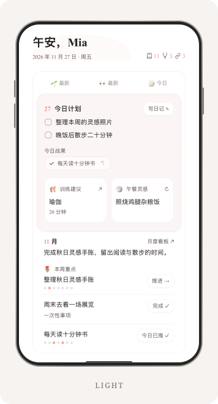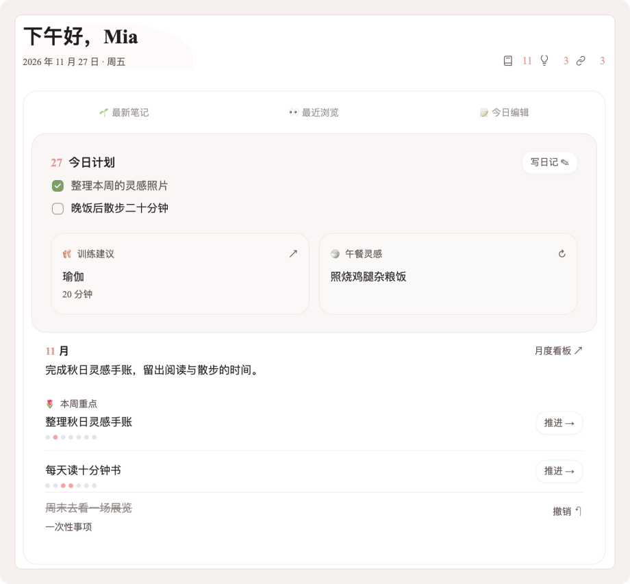

HOME · MOBILE &amp; DESKTOP

## 不必把生活变成一张任务清单

Personal Magazine 是一份住在 Obsidian 里的私人杂志。把生活、艺术、世界见闻与知识探索放在一个首页，打开它，可以是为了记录，也可以只是为了阅读。

**唯一需要主动写的计划，是下周想做些什么。** 不必填写年度规划、月度计划或每日模板。用自己的话写下愿望，AI 负责整理与归类；其他时间，生活本身就是素材。

---

## 01 / EVERYDAY

### 日常的片刻，不必事事有交代

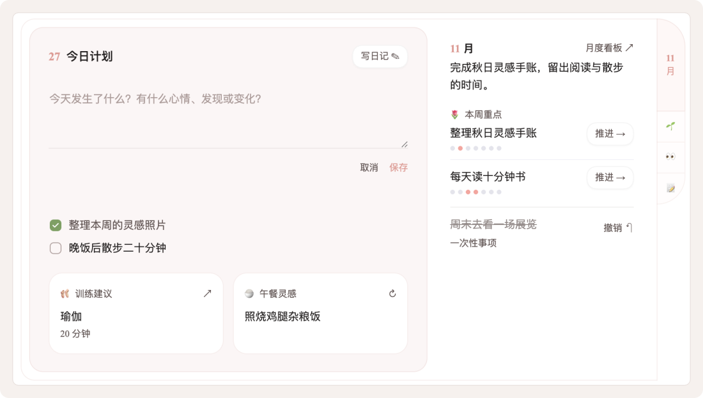

今日安排、日记、真实进展、本周重点与本月方向，都在打开首页时自然出现。运动与餐食灵感只是可选的陪伴。

日记原位展开，持续事项与一次性事项分开记录，进展也可以撤销。桌面用分栏组织信息，手机顺着纵向阅读动线展开。没有必须打卡的日子，也不必用完成率衡量生活。

## 02 / DAILY ART & NEWS

### 给好奇心留一点时间

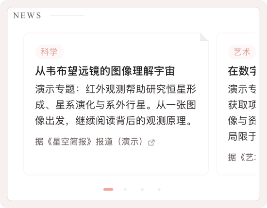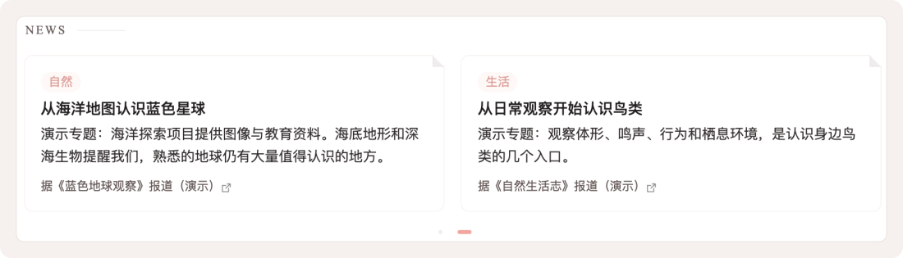

NEWS · 真实首页的新闻剪报局部

每天认识一幅画，从完整画幅、展签与背景故事中慢慢读懂它；再翻几条有来源的世界剪报。艺术采用画廊式展签，桌面图文并置，手机上图下文，赏画入口则留给想深入阅读的人。

新闻采用纸张折角与轻量卡片，手机横滑、桌面双卡。内容有边界，读完就可以离开，不必陷入无尽的信息流。

## 03 / TODAY'S EXPLORATION

### 与过去的知识重逢

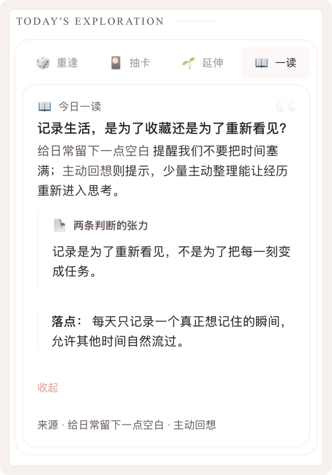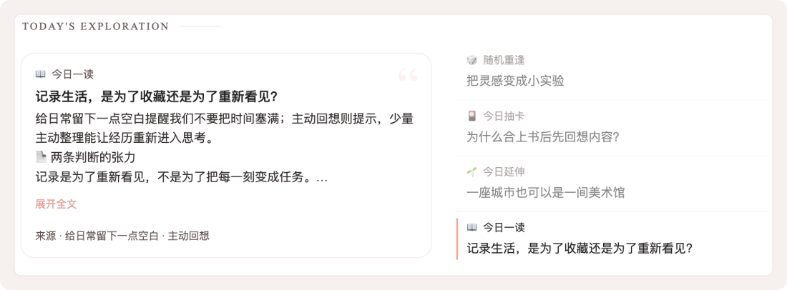

收藏过的知识，不必等到某天主动搜索才重新出现。首页为它们留出四种阅读方式：

| 随机重逢 | 今日抽卡 | 今日延伸 | 今日一读 |
| :--- | :--- | :--- | :--- |
| 再遇一篇旧笔记 | 回想一个概念 | 从兴趣走向新问题 | 换个角度理解旧知识 |

手机以页签切换，电脑以左侧阅读卡与右侧目录组织内容。刊头的笔记、概念与双链统计，以及近期书签，则是随手可用的知识入口。四种方式不是四项每日任务。

---

## 从一句话，到自己的生活年鉴

> 下周想去看展，继续读那本书，有空就散散步。

这是唯一需要主动写下的计划。不必规定每一天，也不必先为意愿分类。

**每周 · 说说想做什么。** AI 从自然语言里识别一次性事项和持续性的意愿，整理每周重点，结合已有记录辅助更新今日安排与月度方向。

**平日 · 留下真实的生活。** 在 Home 随手记下发生的事、心情、愿望，或今天实际做了什么。想写时写，想读时读；空白的日子不必补齐。艺术、新闻与知识探索由独立 AI 工作流提供新的阅读内容。

**时间久了 · 自然形成回望。** AI 根据真实记录自动汇总日、周、月、季、年的生活回望；月度看板与年度生活地图承接这些片段，计划和实际发生的事始终分开。

不是先设定宏大的年度目标，再向下分解任务；而是先生活，再让时间里的片段逐渐显现出自己的形状。

## 随 Obsidian 变换的色彩

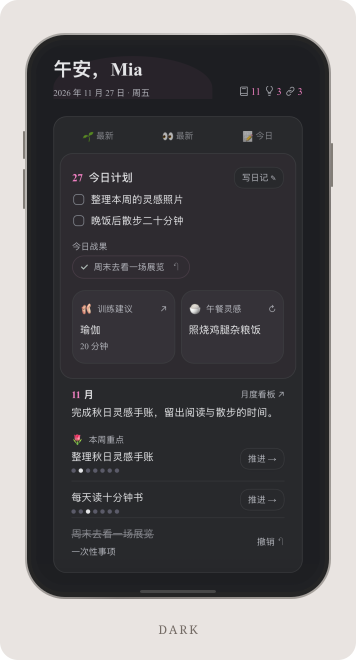

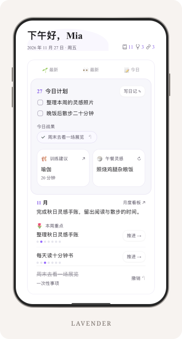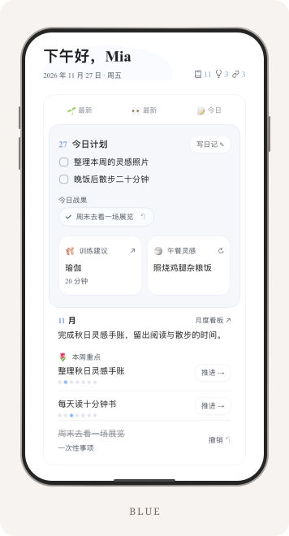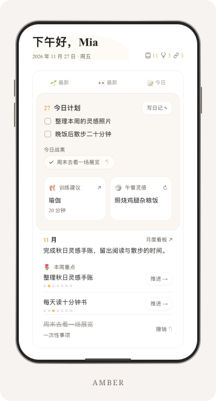

Home 没有固定皮肤。纸面、卡片、强调色、边框和操作控件沿用 Obsidian 的主题变量与动态混色。换一个主题或强调色，首页便有了不同的气质；阅读层级与交互保持一致。

当前为简单的产品演示。展示图来自真实界面截图，按阅读情境裁切与排版；AI 整理与日更依赖独立工作流，并非 Obsidian 原生功能。
