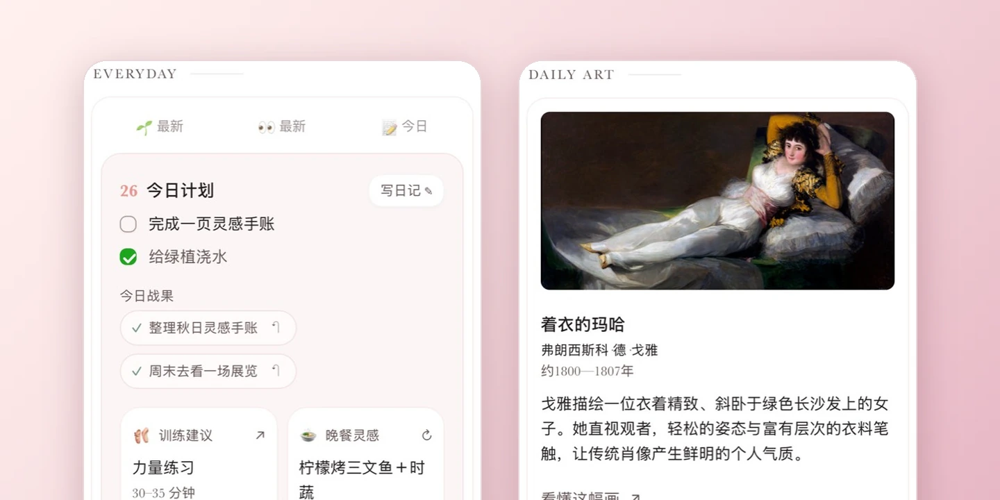

<strong>Personal Magazine</strong> · 手机实机预览

<h1 align="center">一个每天都想打开的 Obsidian 首页</h1>

安排今天，看一幅画，再遇见一篇快忘了的旧笔记。

  <a href="assets/README.md"><strong>看手机实机预览 ↗</strong></a>
  &nbsp;·&nbsp;
  <a href="#关注上架">关注上架</a>

  

## 打开后的几分钟

**先看看今天。** 勾掉一项待办，记下本周推进了哪一步，或者就在首页写一段日记。训练建议和晚饭灵感也在这一页。

**给自己留一幅画的时间。** 从完整画作看到笔触和布料，再拉开说明读画里的故事。想换换脑子，也能抽一道问题，或读到一篇从旧笔记里翻出来的新线索。

**过一阵，再回来看。** 月度看板分开记录计划和实际做过的事。到了年底，翻一翻读过的书、看过的展、实现的愿望，还有那些没写进计划的生活片段。

[看今天计划、赏画、知识探索和年度生活地图的实机画面 →](assets/README.md)

## 关注上架

现在公开的是日常使用中的个人版本预览。正式模板计划付费发布，价格、上架时间和安装要求会在发布时公布。

想收到上架消息，可在仓库顶部选择 **Watch → Custom → Releases**。

[查看发布页 →](https://github.com/jadecoltrane/Obsidian-Home/releases)

---

现有个人版本基于 Obsidian、Markdown、CSS snippets 和 DataviewJS。部分内容日更依赖独立的 AI 工作流。[阅读设计笔记 →](docs/design-notes.md)
