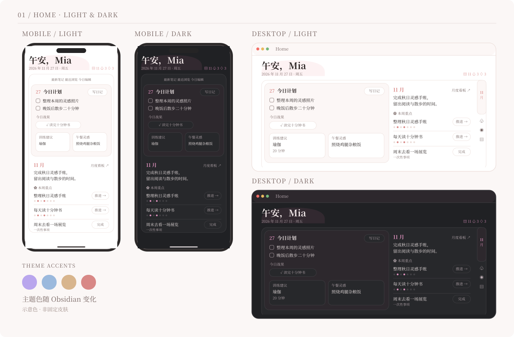
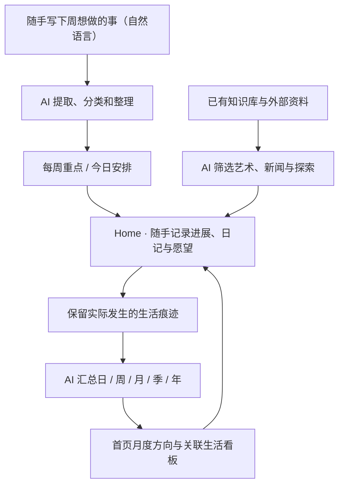

PERSONAL MAGAZINE · OBSIDIAN HOME

<h1 align="center">把生活过成一份自己的杂志。</h1>

不必管理人生，只需让生活留下痕迹。

生活记录 · 每日艺术 · 世界剪报 · 知识探索

## 一个没有绩效感的个人首页

Personal Magazine 是一个基于 Obsidian 的个人生活与知识首页演示。它不是要求你持续打卡、制定年度目标、检查完成率的效率工具，而是一份每天可以随手翻开的私人杂志。

**唯一需要主动写的计划，是下周想做些什么。** 用自然语言随便写一段话，AI 负责提取、分类并整理成每周重点；日常安排、月度方向以及日、周、月、季、年的回望，都可以由 AI 根据已有计划与实际生活记录生成或更新。记录生活与表达愿望不需要固定格式，也不必每天都来。

双端首页 · 浅色 / 深色 · 随 Obsidian 主题与强调色改变

## 01 / EVERYDAY · 日常生活

把今天想做的事、真实发生的事、本周重点和本月方向放在首页。随手写下日记、记录一次进展，或者只看看训练与餐食灵感，都可以。

设计上，今日计划与日记原位操作，周事项区分持续推进和一次性完成；手机纵向阅读，电脑左右分栏。勾选只是方便记录，进展可以撤销，没有必须完成的打卡任务，也不以连续天数、排名或完成率评价生活。

## 02 / DAILY ART & NEWS · 给生活一点好奇心

每天读一幅画、一段作品背景，再看几条世界的消息。画作采用展签式排版，电脑左图右文，手机上图下文；新闻以纸张折角与横滑卡片呈现，保留来源和继续阅读的入口。

设计上，把艺术和新闻放进日常首页，而不是另外打开一个信息流。内容有边界，读完即可离开，也可以跳过。

## 03 / TODAY'S EXPLORATION · 让知识重新流动

知识库不必只在想起关键词时才有用。首页每天提供四种轻量的阅读方式：**随机重逢**，再遇一篇旧笔记；**今日抽卡**，回想一个概念；**今日延伸**，顺着兴趣发现问题；**今日一读**，从新的角度阅读已有知识。

设计上，手机用四项切换与单卡阅读，电脑用左卡右目录。刊头统计及最新笔记、最近浏览、今日编辑是随手可用的知识入口，不要求每天完成所有探索。

## 04 / 信息如何流动

例如，周末只需要写：「下周想去看展，晚上多散散步，继续读那本书，有空整理一下照片。」AI 可以将它整理为一次性事项、持续事项与适合本周的生活重点，并根据这些意愿和已有记录辅助更新今日安排。

日记、实际进展、愿望和已经发生的经历保留原本的意义；AI 负责组织它们，而不是反过来要求用户填满年计划、月计划或每日模板。月度生活看板和年度生活地图承接更长的时间跨度，让零散的生活记录逐渐形成回望。没有记录的日子无需补齐；总结只依据已有信息，不把计划当成事实。

## 05 / 跟随你的 Obsidian

Home 使用 Obsidian 的主题变量和动态混色：纸面、强调色、按钮、卡片、链接和细线随当前主题调整。浅色与深色保持相同的信息结构，颜色不局限于展示中的粉色；切换主题或强调色，首页也随之变化。

> 这是简单的产品演示，图片是基于现有设计的 UX 展示模型，内容为示例。AI 更新依赖独立的 AI 工作流，并非 Obsidian 原生功能；本仓库不是完整可安装模板。

[更多设计思路 →](docs/design-notes.md)
