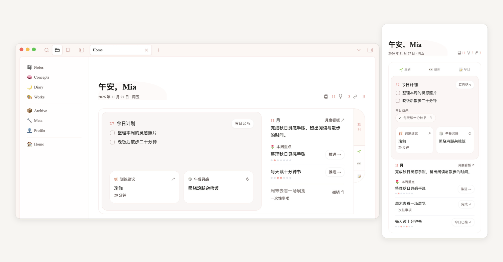

# AI 日常看板与阅读系统

Obsidian Home 是一个放在 Obsidian 里的个人首页。每周写几句想做的事，AI 把它们整理成本周重点和每日安排。每天打开首页，可以看今天要做什么、记下真正发生的事，也可以看一幅画或重读一条旧笔记。日子久了，月看板和年看板会把散落的记录放回一条时间线上。

## 从一句话开始

> 下周想每天读十分钟，周末去看一场展，再找时间整理灵感照片。

**每周写一次。** AI 会从这段话里分出持续事项和一次性安排。「每天读十分钟」可以持续记录进展，「周末去看展」是做完就能划掉的一件事。整理后的内容放进本周重点，和每天打开首页时看到的安排相连。

**平时记录发生了什么。** 照片整理到一半，或临时换了一个展，都可以在日记或进展里留一笔。月底回看时，当初想做什么和后来做了什么都找得到。艺术、新闻和知识探索由另一条工作流更新，想阅读的时候，打开首页就有一个起点。

## 日常生活

早上可以先扫一眼「今日计划」，再看「本周重点」里有哪些事情还在推进。持续做的事可以更新进展，一次性的安排可以在完成后标记。想临时改计划，也可以直接编辑「本周重点」，增删事项、调整类型，或为某一项补上备注。训练建议和午餐灵感放在旁边，想活动一下或还没想好吃什么时，可以随手看看。

点「写日记」就能在首页展开编辑区，记一件事、几句感受，或者今天想留下来的细节。想找回已经写过的内容，也有按标题搜索和按分类浏览的入口。电脑上可以并排读计划和周重点，手机上顺着同一页往下翻。

## 每日艺术与新闻

每天从一幅画开始。电脑上把画幅和展签并排放，可以边看构图和细节，边读作者、年代和作品简介。手机上点开「看懂这幅画」，可以用更大的画面赏画，再往下读创作背景和作品故事。

画作下面是几条新闻剪报。先扫标题和短摘要，遇到感兴趣的内容，再从卡片里的来源接着读。手机上横向翻阅，电脑上可以同时看到两张卡片。

## 今日探索

存进 Obsidian 的笔记，也可以换个方式再读一次。想随手翻翻，可以选随机重逢。想检验自己到底记得多少，可以抽一道题。想多读一点，还有顺着一个问题往外找资料，以及把旧笔记从头读一遍的入口。手机上通过页签切换，电脑上可以同时看到当前卡片和其他入口。

### 随机重逢

随机翻出一条旧笔记，看看它是什么时候写下的。比如再次遇见「把阅读变成一次主动回想」，先读卡片上的一小段，也可以点回原笔记，找回当时是怎么想到这个点子的。

### 今日抽卡

从读过的内容里抽一道问题，例如「为什么合上书后先回想内容？」题面先留给你一点思考时间，想好了再打开参考答案。卡片也保留笔记来源，想弄清某个观点的来龙去脉，可以读回原文。

### 今日延伸

从原笔记里的一个想法多走一步。例如「一座城市也可以是一间美术馆」这张卡，从一次普通散步出发，把门窗、光线和材料变成可以留心观察的东西。卡片一并留下参考资料和原笔记，读完可以继续追下去。

### 今日一读

从一个问题、反例或新联系出发，重新读熟悉的笔记。「记录生活，是为了收藏还是为了重新看见？」就从一条关于给日常留白的笔记里展开。首页先给一段摘录，有兴趣可以展开全文，再回到那条引出问题的原笔记。

## 月看板 / 年看板

### 月看板

按月份切换，先看到当时的生活方向，再看从每周汇入的安排和已经记下的实际经历。比如一个月里几次提到想看展，可以在月看板里对照计划和记下的出行日期。月度回顾保留了「打开当月日记」的入口，想起一个细节时可以回到当时的记录。

### 年看板

把一年拉到同一张生活地图上。想去的地方和想尝试的事可以先放进愿望池，实现后移到「今年实现了」。读过的书、看过的电影和听过的音乐也有位置。年末回头看，可以从这些具体的小事里找出这一年反复关心的主题，以及那些后来变得重要的兴趣。

## 主题跟随 Obsidian 变化

首页用清浅的纸面和细分隔线组织内容。日记有地方写，艺术区像翻到一张展签，新闻像随手翻几则剪报。切换 Obsidian 的浅色、深色或强调色时，背景、卡片和操作提示会一起变化。下面用四张完整的手机首页首屏对照淡紫、雾蓝、暖橙和深色。从顶部问候到本周重点，可以看到主题如何影响整页。

当前为产品演示。AI 整理与内容更新由独立工作流负责。封面为功能示意，章节配图使用真实界面截图。
