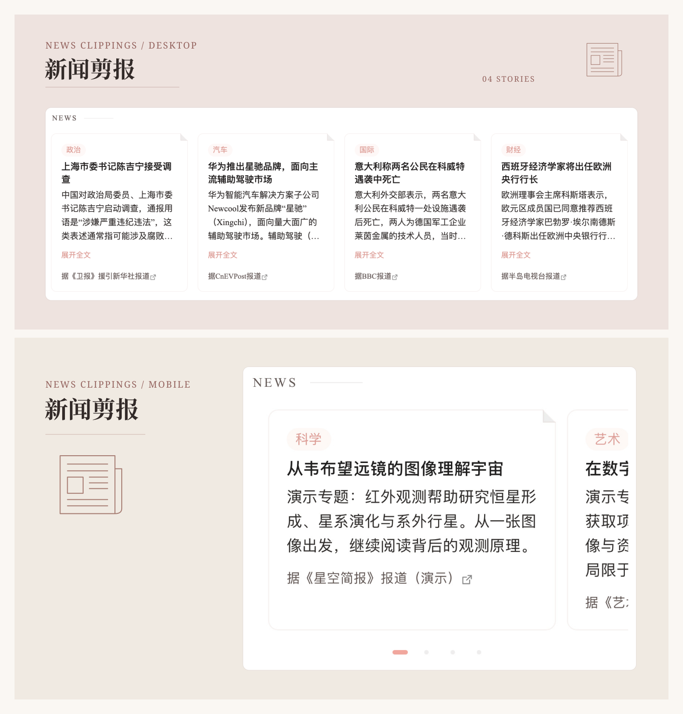
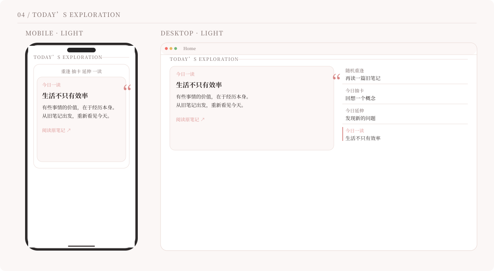
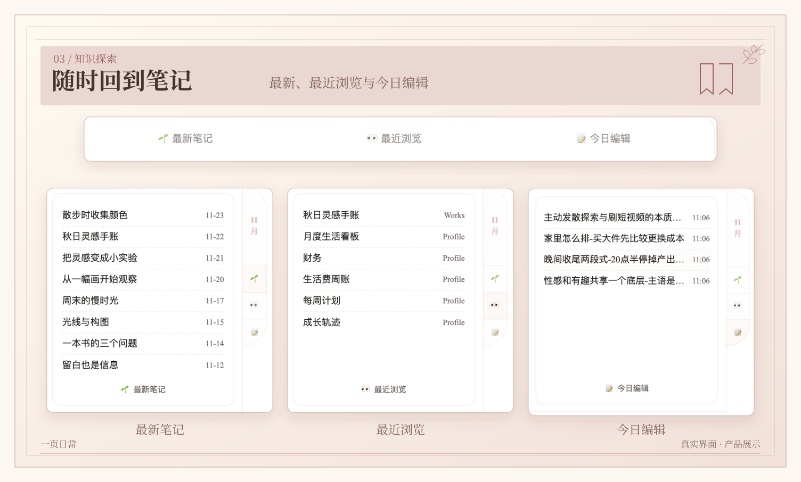
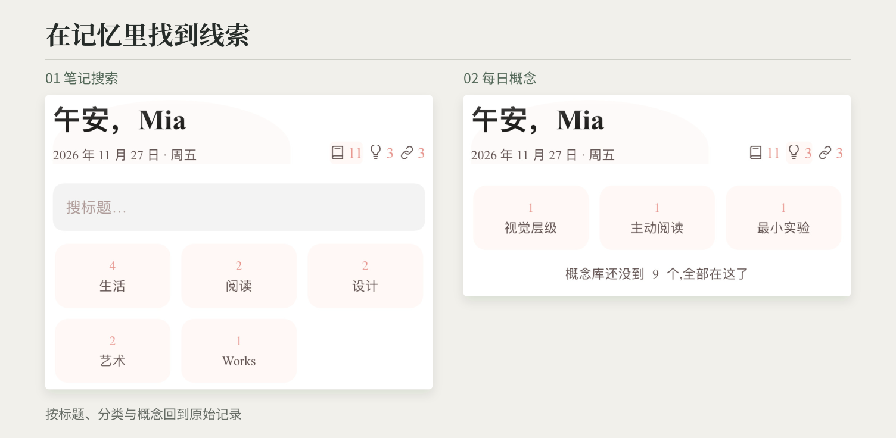

# 一页日常

**为日常生活而设计的 Obsidian 首页。**

每周写下想做的事，每天留下发生的事。在计划与记录之外，也为艺术、阅读和新的灵感留一点空间。随着时间推移，这些日常积累成一份可以随时回望的生活记录。

## 从一句话开始

> 下周想每天读十分钟，周末去看一场展，再找时间整理灵感照片。

不必先填表格，也不必逐项安排。每周写下一段自然语言，AI 将它整理成本周重点与每日计划。

持续做的事可以记录进展，一次性的安排可以在完成后标记。计划改变了，也能随时调整。

每天打开首页，看看今天的安排、训练建议与午餐灵感；到了晚上，写几句日记，留下当天真正发生的事。

## 每天发现一点新东西

日常不只有待办事项。首页也留出一块空间，用来接触生活之外的世界。

**每日一画** — 从一幅画开始，慢慢看它的构图、细节，以及作品背后的故事。画幅与展签相伴，像是每天经过一间小小的美术馆。

**新闻剪报** — 几则每日新闻，先读摘要，再沿着感兴趣的话题继续阅读。电脑上并排浏览，手机上逐张翻阅。

## 让旧笔记重新参与今天

记下一个想法，并不意味着探索已经结束。

「今日探索」从已有笔记出发，让过去的积累以四种方式重新进入日常：**随机重逢**带回旧笔记，**今日抽卡**唤起主动回想，**今日延伸**引向新的问题，**今日一读**则提供另一种理解熟悉内容的视角。

比如，从「一座城市也可以是一间美术馆」出发，重新留意散步时经过的门窗、光线与材料。每张卡片都保留回到原笔记的入口，让新的思考与过去的记录保持联系。

最近浏览、最新笔记、今日编辑、标题搜索与概念卡片也集中在首页，方便随时回到正在关注的内容。

更多笔记浏览与检索界面

## 从今天，到一年

日记不只记录当下，也是回望生活的起点。

**月看板**把当时想做的事与真实发生的事放在一起。月底回顾这个月去了哪里、推进了什么，也可以从回顾重新打开那一天的记录。季度回望则从几个月的经历中寻找变化。

**年看板**是一张更长时间尺度的生活地图。想去的地方、想尝试的事、实现的心愿，以及读过的书、看过的电影和听过的音乐，都有自己的位置。

年末回头看，留下的不只是一份完成清单，还有这一年逐渐形成的兴趣与生活轨迹。

## 同一种体验，不同的屏幕

桌面上展开阅读，手机上随手记录。清浅的纸面、细分隔线、画作与剪报，共同构成统一的视觉语言。

首页跟随 Obsidian 的浅色、深色主题与强调色变化，在不同设备和配色下保持一致的设计。

## 关于实现

一页日常是 Obsidian 的自定义首页。每周计划整理、每日内容更新与月度、季度及年度回顾由独立 AI 工作流负责；实际进展和日记仍由使用者记录。

所有产品界面均来自实机截图。
