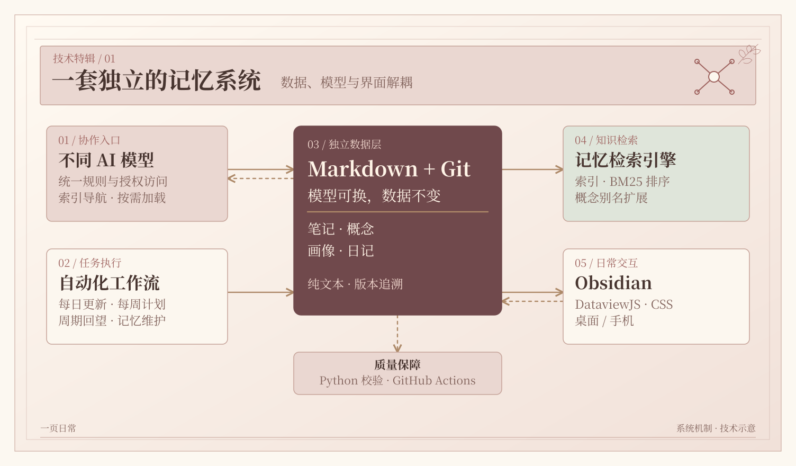
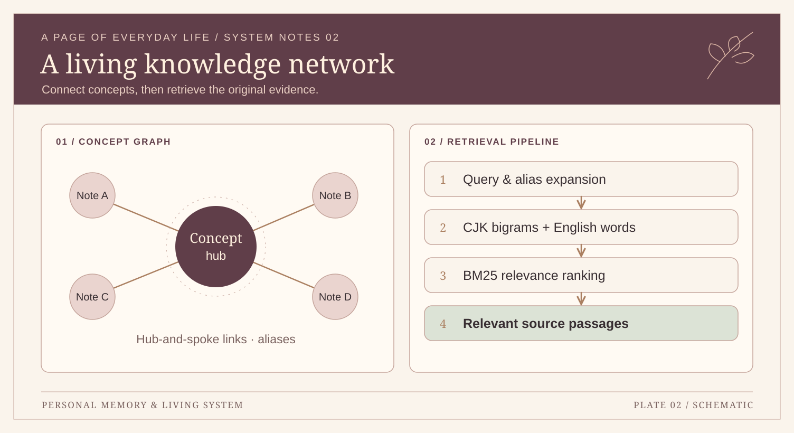
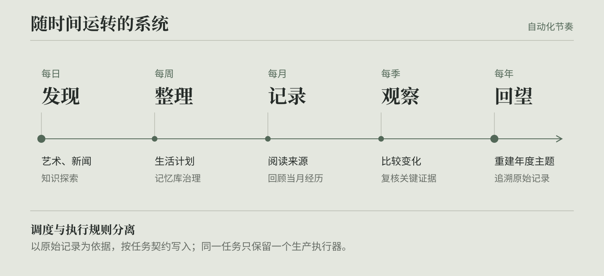
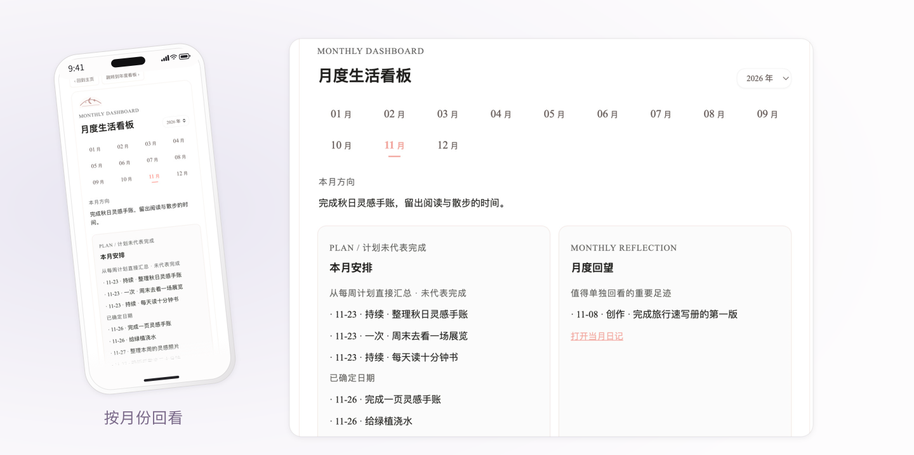
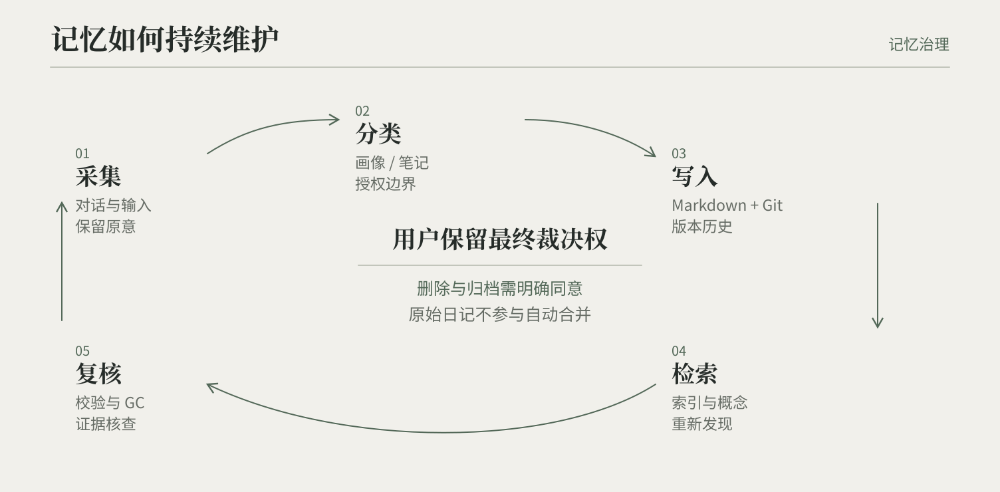

# 一页日常 · A Personal Memory & Living System

**一个由 AI 协作驱动的个人知识与生活系统。**

以 Markdown 和 Git 为长期记忆底座，以 Obsidian 为日常交互界面。把生活计划、真实经历、知识探索与艺术阅读放进同一个持续生长的数字空间。

`Markdown + Git` · `Obsidian / DataviewJS` · `Python / BM25` · `GitHub Actions` · `AI Workflows`

## 设计初衷 · Design philosophy

我想做的不是另一个待办清单，也不是一个只负责收藏的知识库。生活里的计划、经历和曾经思考过的事，应该能够在日常中再次相遇。

因此，我把系统分成三个相互独立又彼此关联的部分：**人决定生活如何进行，AI 协助整理与发现，数据始终保留在自己的记忆库中。** 界面可以变化，模型可以更换，过去留下的记录仍然可以读取、检索和回望。

## 系统架构 · System architecture

一页日常是私人 Memory 系统的可视化入口，而不是长期记忆本身。后台以纯文本文件与 Git 版本历史保存数据，前端通过 Obsidian、DataviewJS 和 CSS 呈现交互；AI 则通过授权的仓库访问与统一协作规则进行按需读写。

- **数据与模型解耦**：笔记、概念、画像与日记均保存在 Markdown 中，不依赖某一模型的内置记忆。
- **统一协作协议**：以共享的 AGENTS.md 为入口，兼容其他 AI 工具的规则入口，先读索引，再按任务加载相关上下文。
- **数据与界面分离**：日常页面读取源数据，自动化任务按契约更新指定内容，不随日更重写固定布局。

## 从一句话开始 · Everyday experience

> 下周想每天读十分钟，周末去看一场展，再找时间整理灵感照片。

每周写下一段自然语言，AI 将明确日期的安排与需要持续推进的事项分别整理。每天打开首页，看看今日计划、本周重点、训练建议与午餐灵感；晚上写几句日记，留下当天真正发生的事。

持续事项可以记录进展，一次性事项可以标记完成。计划与实际行动分别保存，避免把想做的事误当成已经发生的事实。

交互并非只读看板：计划支持原位编辑、完成与撤销，实际进展从日期记录恢复。写入时校验源数据，避免覆盖其他日期或并发修改。

## 每天发现一点新东西 · Daily edition

日常不只有待办事项。首页也留出一块空间，用来接触生活之外的世界。

**每日一画** — 从一幅画开始，慢慢看它的构图、细节与故事。画幅与展签相伴，像是每天经过一间小小的美术馆。

**新闻剪报** — 几则每日新闻，先读摘要，再沿着感兴趣的话题继续阅读。电脑上并排浏览，手机上逐张翻阅。

## 让知识持续生长 · Knowledge engine

长期记忆不只是存储，还要能够重新找到、理解和使用。Memory 将概念作为知识关联的枢纽，以 Hub-and-Spoke 结构组织笔记，并通过概念别名扩展检索范围。

检索脚本使用中文二元组与英文分词、BM25 相关度排序和概念 aliases 扩展，返回相关原文片段。它以 Python 标准库实现，无需外部向量数据库或嵌入 API；现阶段优先保持可移植性与低依赖。

在界面上，「今日探索」把知识重新带回日常：**随机重逢**带回旧笔记，**今日抽卡**唤起主动回想，**今日延伸**引向新的问题，**今日一读**提供新的理解视角。每种探索都保留来源入口。

笔记浏览、搜索与概念入口

## 随时间运转的系统 · AI automation

自动化任务不是不断生成更多文字，而是让不同时间尺度上的信息有明确归宿。每日更新内容，每周整理计划并维护记忆，每月、每季度和每年依据原始记录进行回望。

调度与执行规则分离：任务定义、数据范围、写入边界与校验约定保留在记忆库中，同一周期任务只允许一个生产执行器。更换具备授权和相应能力的 AI，不需要迁移个人记忆本身。

## 从今天，到一年 · Reflection

**月看板**把当初想做的事与真实发生的事放在一起。季度回望比较数月间的变化，并回到关键原始记录核实。

**年看板**是一张更长时间尺度的生活地图。想去的地方、想尝试的事、实现的心愿，以及读过的书、看过的电影和听过的音乐，都有自己的位置。

年末回头看，留下的不只是完成清单，还有逐渐形成的兴趣与生活轨迹。长期回望不将 AI 建议当作实践，也不以计划推断完成。

## 让记忆保持可靠 · Memory governance

长期使用 AI，难点不只是让它记住更多，而是防止重复、错误与未经确认的推断逐渐污染记忆。

| 机制 | 实现 |
| --- | --- |
| 分类与权限 | 画像与知识笔记分开维护；收藏、归档及删除遵循用户授权边界。 |
| 知识维护 | 周期性检查重复笔记、概念别名与关联，保留事实与推论的区别；需人工决策的变更交由使用者裁决。 |
| 可追溯性 | Git 版本记录、原文链接、来源与复核状态让变更可以追查。 |
| 自动化质量检查 | Python lint 检查断链、frontmatter 与结构约束；GitHub Actions 配置了回归测试与索引重建。 |
| 安全写入 | 约定读取最新版本、校验数据与处理并发冲突；日记作为真实记录，不参与自动去重合并。 |

## 同一种体验，不同的屏幕 · Design system

桌面上展开阅读，手机上随手记录。纸面、细分隔线、画作与剪报构成统一的视觉语言；保留丰富的编辑式细节，同时尊重移动端与桌面的阅读节奏。

首页跟随 Obsidian 的浅色、深色主题与强调色变化。交互层在兼容情况下复用渲染实例、保留分页与展开状态；当增强功能不可用时，仍尽量保留原始 Markdown 内容。

## 技术栈 · Technical stack

| 层级 | 技术与设计 |
| --- | --- |
| 数据层 | Markdown、YAML frontmatter、Git |
| 界面层 | Obsidian、DataviewJS、CSS、响应式布局 |
| 检索层 | Python、BM25、中文二元组、概念别名 |
| AI 协作 | 共享规则入口、上下文按需加载、任务契约 |
| 自动化与校验 | GitHub Actions、索引生成、lint、回归测试 |

本仓库是公开的产品展示；实际记忆数据、AI 工作流规范与实现位于独立私有仓库，不在此处公开。架构图为机制示意，任务时间轴描述工作流契约，不代表对每次调度的运行状态作出保证。

产品界面均来自已有实机截图；技术信息图为原创矢量示意。
