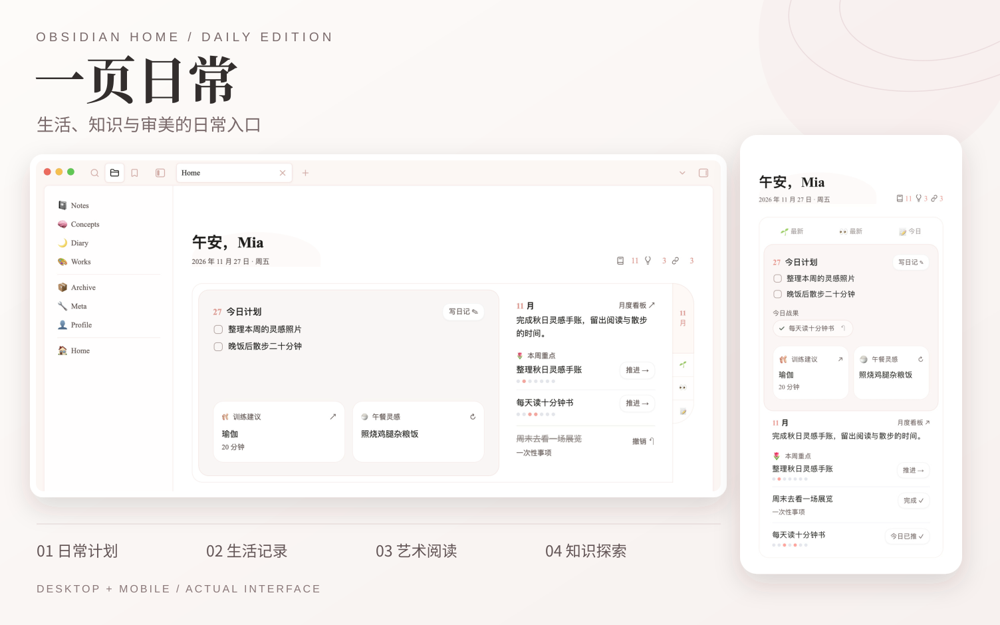
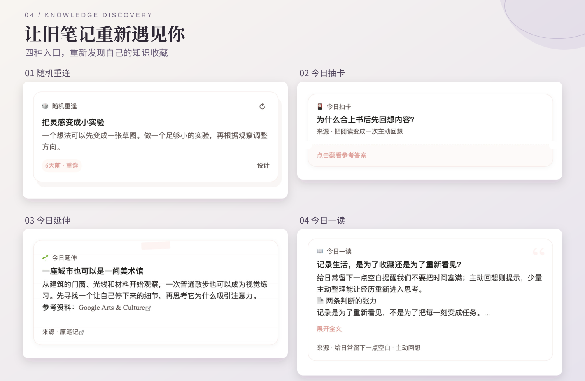
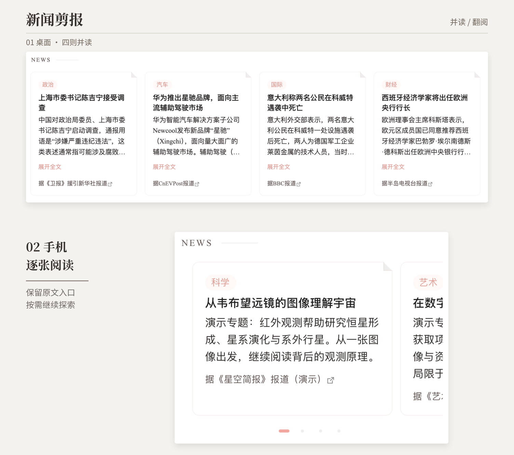
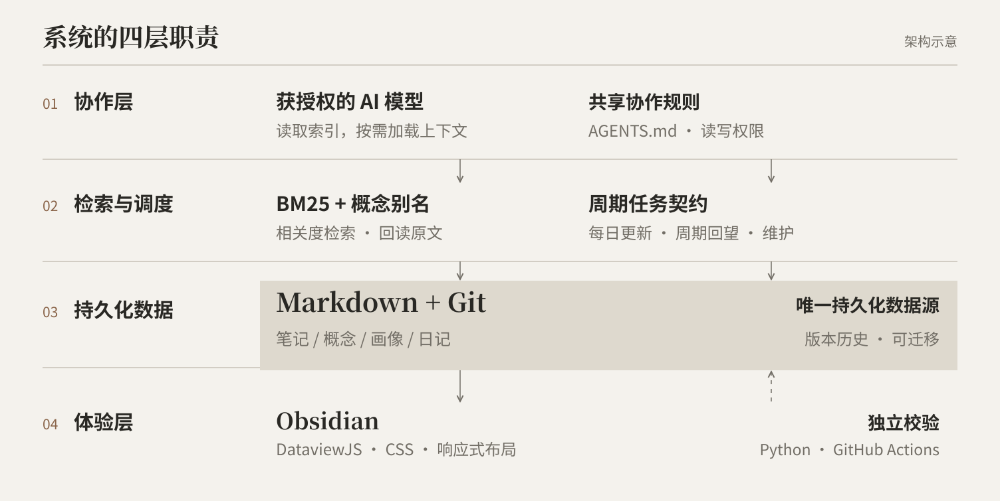
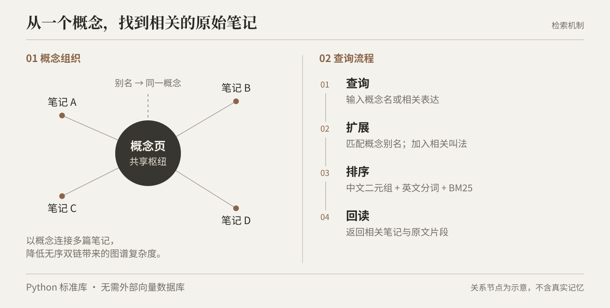
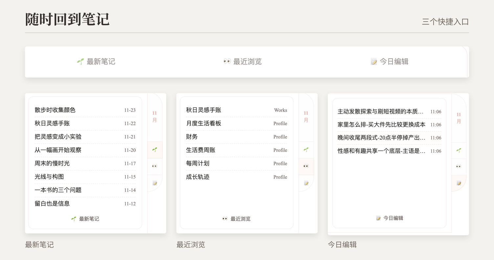
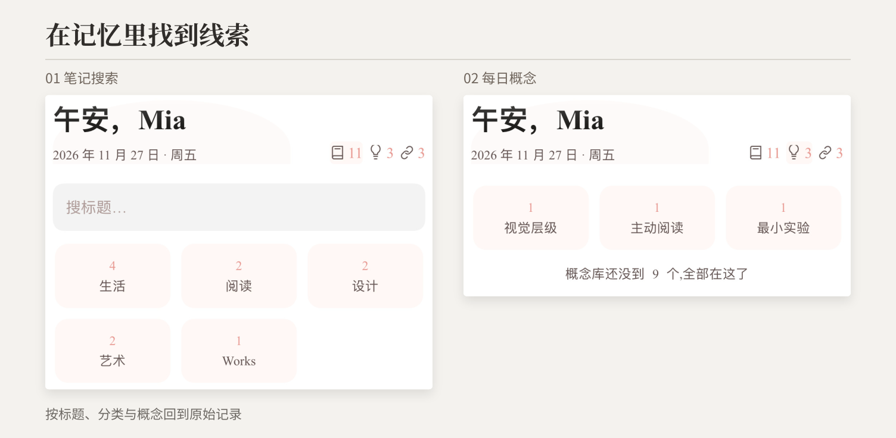
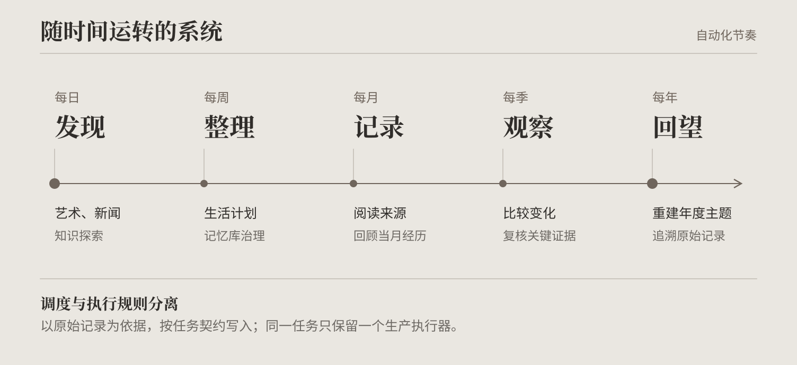
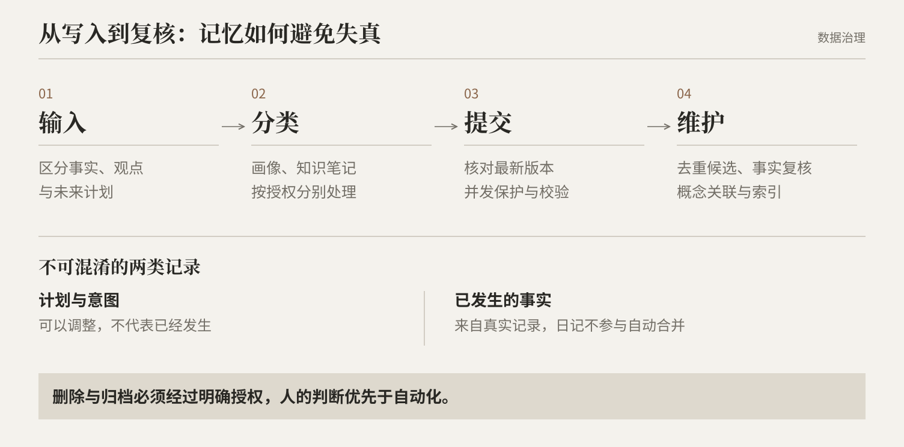

# 一页日常

**一个由 AI 协作驱动的个人知识与生活系统。**

用 Obsidian 阅读与记录生活，用 Markdown 和 Git 保存长期记忆，让 AI 协助整理、检索与回望。界面可以变化，模型可以更换，积累下来的知识与经历始终属于自己。

## 01 · 产品体验

记忆的价值不只是被保存，更在于能够再次被使用。一页日常把计划、生活记录、艺术阅读与知识探索放在同一个日常入口。

**从一句话开始。** 每周用自然语言写下想做的事，AI 将明确日期的安排与持续推进的事项分别整理。每天记录真实进展，随时调整计划；晚上写几句日记，留下真正发生的事。

**每天发现一点新东西。** 每日一画将作品与展签并置，新闻剪报保留原文入口。知识探索则通过随机重逢、主动回想、主题延伸和今日一读，让旧笔记重新进入今天。

查看日常计划、日记编辑与新闻剪报

## 02 · 系统架构

首页并不是记忆本身，而是长期记忆系统的交互出口。架构分离数据、AI 协作、检索与界面：数据保存在独立的 Git 仓库中，AI 依据统一规则按需访问，Obsidian 负责日常呈现和操作。

| 设计决策 | 为什么这样做 |
| --- | --- |
| Markdown + Git | 保留可读、可迁移的原始记录与版本历史，不依赖单个模型的内置记忆。 |
| 统一协作入口 | 使用 AGENTS.md 共享读写规则；先读索引，再加载相关上下文，避免无关信息占用上下文。 |
| 数据与界面分离 | 自动化只更新约定的数据字段和内容，日常更新不重写固定布局。 |

## 03 · 核心技术

### 检索与概念网络

笔记以概念为枢纽建立关联，检索通过概念别名扩展查询，并使用中文二元组分词、英文分词和 BM25 相关度排序返回原文片段。

**为什么不直接采用向量数据库？** 当前的个人知识库以可读文本和概念关联为基础。BM25 与别名扩展可用 Python 标准库实现，无需额外服务和嵌入 API；语义关联来自概念组织，相关度来自检索算法。这样做保留了低依赖与可迁移性，但不能等同于向量语义搜索。

查看笔记浏览、标题搜索与概念入口

### 自动化与记忆治理

日、周、月、季、年有各自的任务契约。调度与执行规则分离，同一个周期任务只允许一个生产执行器。不同 AI 可以按授权和能力接入，但不会因此迁移或复制记忆数据。

长期记忆的可靠性比单纯增加记忆数量更重要。写入前核对最新版本与授权范围，维护时区分事实、推论、重复候选与用户裁决。

- **结构校验**：Python lint 检查断链、元数据和结构约束，GitHub Actions 配置回归测试及索引重建。
- **语义维护**：周期性检查重复、概念别名与事实证据，未经明确授权不自动归档或删除。
- **原始记录保护**：日记不参与自动去重合并；计划不能作为完成证据，实际推进与一次性完成分别记录。

## 04 · 交互设计

这不是静态仪表盘。真实界面支持计划的原位编辑、完成与撤销，并从原始日期记录恢复状态。桌面与手机共享数据和设计逻辑，而不是各自维护一套记录。

| 实现难点 | 处理方式 |
| --- | --- |
| DataviewJS 重绘导致状态丢失 | 兼容时复用渲染实例，保留分页、展开和编辑状态；只在相关数据发生变化时更新。 |
| 多端写入可能覆盖原始记录 | 保存前核对最新源数据与相关日期，拒绝冲突，保留其他日期及历史内容。 |
| 移动端与桌面布局不同 | 根据实际容器调整网格和横向阅读方式，保留原生触控及键盘入口。 |
| 增强交互不可用 | 尽量回退原始 Markdown，而不是让内容依赖某个界面组件才可读。 |

## 05 · 长期回望

每天的日记与实际进展是原始事实层，月度、季度和年度回望是不同时间尺度的观察，不把计划和 AI 建议误当作实践。月度看板将当时的方向与真实经历放在一起，年度地图则保留愿望、足迹和书影音。

查看年度生活地图

---

**实现技术**：Markdown · Git · YAML · Obsidian · DataviewJS · CSS · Python · BM25 · GitHub Actions

本仓库是公开的产品展示，实际记忆数据与 AI 工作流规范位于独立私有仓库。界面来自已有实机截图，技术图为机制示意；任务契约不代表每次调度的实际运行结果。
