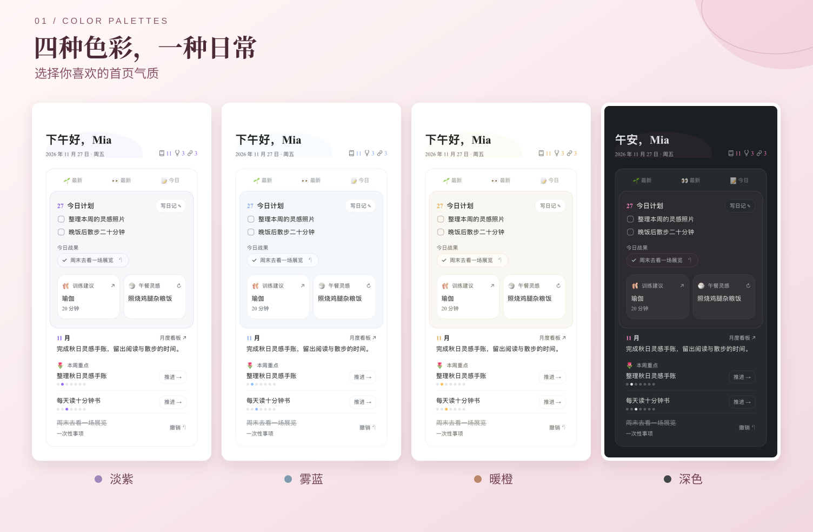
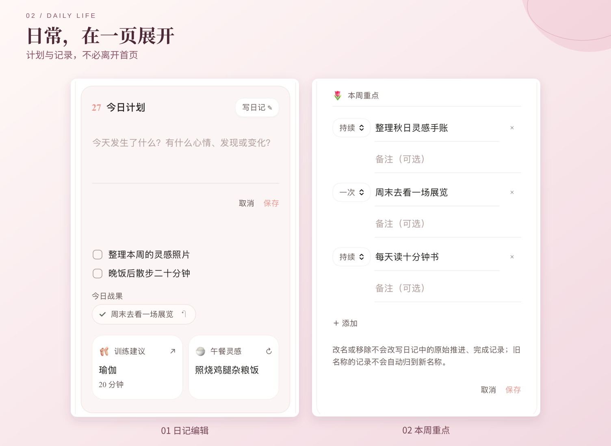
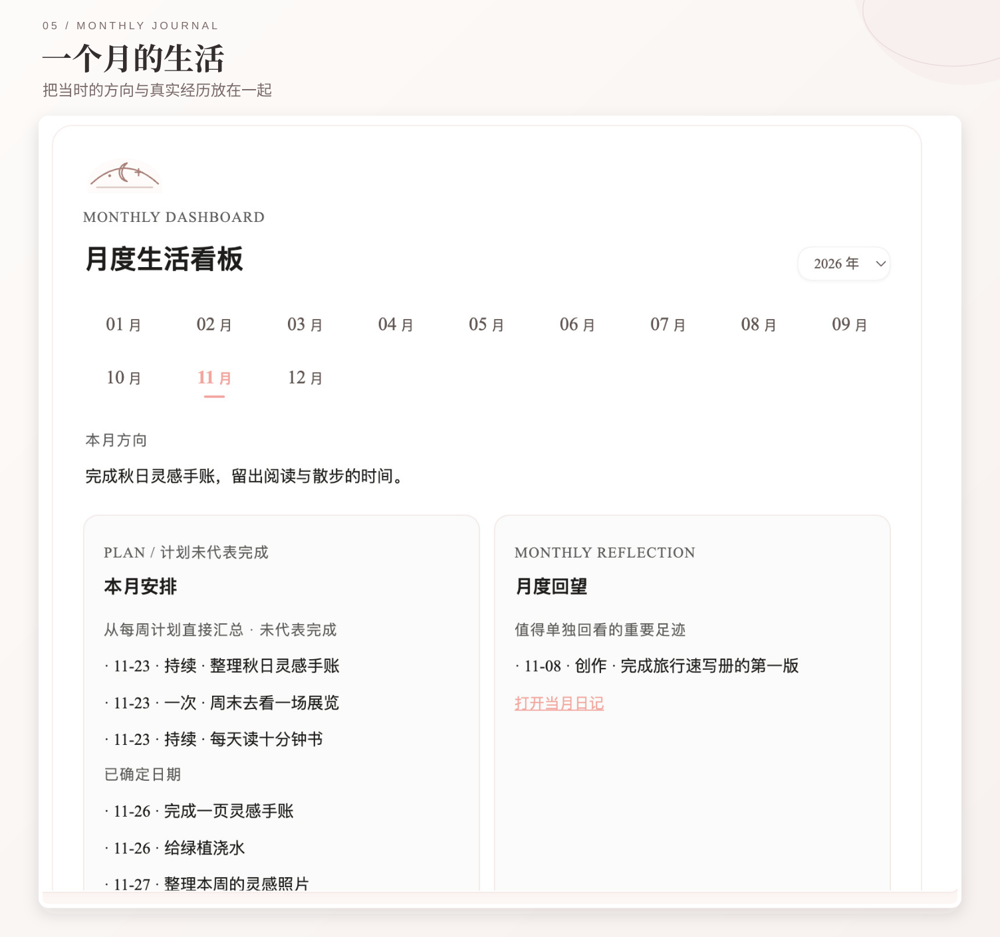
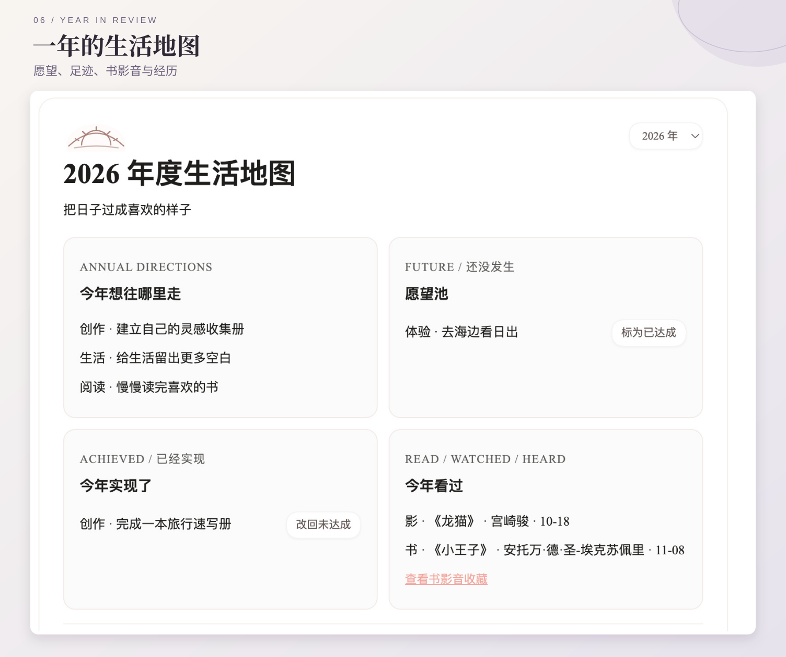

<h1 align="center">一页日常</h1>

<strong>把生活、知识与审美，收进属于自己的一页。</strong>

An Obsidian home for everyday living, reading & discovery.

一页日常是一套为 Obsidian 设计的个人生活工作台。它不只整理待办与笔记，也为每天留下一点阅读、艺术和思考的空间。

## 01 · 选择喜欢的色彩

淡紫、雾蓝、暖橙与深色。不同的主题气质，同一套日常体验。桌面与移动端采用一致的设计语言，布局随屏幕调整。

## 02 · 把日子过得井井有条

每周安排想做的事，每天记录真实进展，晚上写下几句日记。直接在首页编辑计划、完成或撤销事项，不必来回切换笔记。

## 03 · 每天发现一点新东西

**每日一画** — 像走进一间随身美术馆，在画作与展签之间慢慢欣赏。

**知识探索** — 随机重逢、今日抽卡、今日延伸、今日一读，让收藏过的笔记重新参与今天。新闻剪报则保留通往原文的阅读入口。

## 04 · 收藏自己的生活轨迹

月度看板把当时的方向、安排与实际经历放在一起。年度生活地图记录愿望、足迹与书影音，让日子不只是过去，也可以被重新翻阅。

展开查看年度生活地图

## 05 · 不止于首页

一页日常的设计以可读的 Markdown 内容为基础，并可结合 AI 协作，让日常记录逐渐积累为可以检索、回望的个人知识资产。更完整的长期记忆与自动化机制将另行介绍。

## 获取方式

目前为产品展示阶段。正式交付内容、使用要求与购买方式将在发布时公布。上方为现有系统的实机展示，部分功能依赖配套数据与 AI 工作流，最终交付范围以发布说明为准。

---

一页日常 · 独立产品设计 · 基于 Obsidian。本仓库用于产品展示，不包含私人记忆数据。
