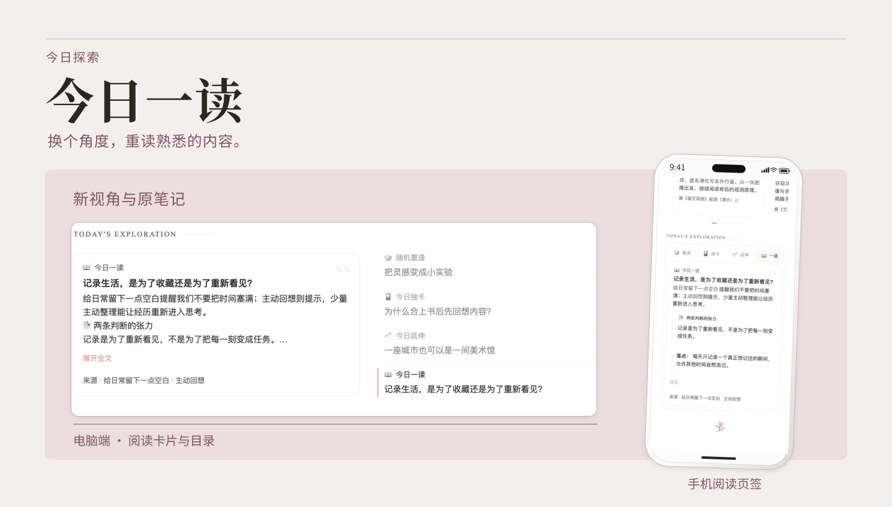

OBSIDIAN · AI-POWERED DAILY HOME

<h1 align="center">Daybook</h1>

AI 日常看板与阅读

让生活有迹可循，让好奇心有处可去。

## 把日子过成自己的样子

Daybook 是一个由 AI 整理内容的 Obsidian 日常看板与阅读空间。生活安排、日记、艺术、世界见闻与知识探索，都在同一个首页自然相遇。

**唯一需要主动写的计划，是下周想做些什么。** 不用制定年计划、月计划，也不必每天填表。说出真实的意愿，AI 负责分类与整理；平日想记录就记录，想阅读就阅读。空白的日子，无须补齐。

---

## 01 · Everyday / 日常

今日安排、周重点、月度方向、运动与餐食灵感，让生活有一个轻松的入口。日记可以原位展开；持续事项与一次性事项分开记录，进展也可撤销。这里不设置必须打卡的日子，也不以完成率评判生活。

## 02 · Art & News / 艺术与见闻

每天与一幅画相遇，从画幅、展签和背景故事慢慢读懂它。再翻几条保留来源的世界剪报。手机赏画支持沉浸阅读；新闻采用纸面折角卡片，手机横滑、桌面双卡，读完便可离开。

## 03 · Exploration / 今日探索

知识库不必等到主动搜索才有价值。四种阅读方式，让过去收藏的知识重新进入今天。

### 随机重逢 · Rediscover

像翻到一张旧明信片，再遇见一篇曾经感兴趣的笔记。

### 今日抽卡 · Recall

票券式问答先留下问题，想一想再翻看答案，让回忆成为轻量的主动阅读。

### 今日延伸 · Explore

沿着已有兴趣向外走一步，在新问题、外部资料和原笔记之间建立联系。

### 今日一读 · Read again

以新的观点、反例或联结重新阅读旧知识。四张卡片可自由选择，不是四项每日任务；手机用页签切换，电脑以阅读卡与目录并置。

---

## 04 · Life in review / 生活回望

### 月度生活看板

本月方向、计划、已经发生的事情和回望汇聚在同一处。月份不是用来结算绩效的期限，而是理解近段生活的一个尺度。

### 年度生活地图

愿望池、已实现的心愿、书影音、经历与年度回望，逐渐勾勒出真实生活的轮廓。不必先写好年度目标，也可以回看自己走过的路。

## 05 · 从一句话到生活年鉴

> 下周想去看展，继续读那本书，有空就散散步。

**每周 · 表达意愿。** 自然语言是唯一必须主动填写的计划输入。AI 提取与归类意愿，区分持续事项与一次性事项，整理每周重点，并结合已有记录辅助更新每日安排和月度方向。

**平日 · 留下生活。** 在 Home 随手记下发生的事、心情、愿望或实际进展。另一路 AI 工作流更新艺术、新闻和知识阅读内容，让首页每天都有新的相遇。

**日、周、月、季、年 · 自动回望。** AI 根据真实记录汇总不同周期的生活，月度看板与年度地图承接这些片段。计划与实际发生的事情始终区分，不把空白补成虚构经历。

先生活，再让时间里的片段慢慢形成自己的形状。

## 06 · Theme / 随主题变换

Daybook 沿用 Obsidian 的主题变量与动态混色。切换浅色、深色或强调色，纸面、卡片、文字与操作控件随之变化；信息层级与交互保持一致。

当前为产品演示。海报基于真实界面截图裁切与排版，手机状态栏为模拟展示；AI 整理和内容更新依赖独立工作流，并非 Obsidian 原生功能。
