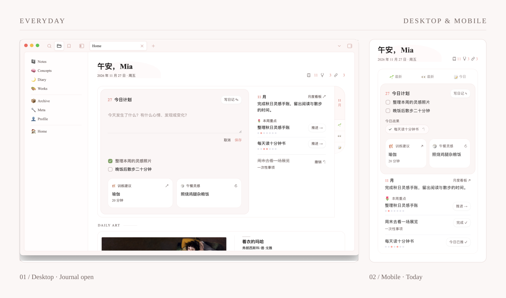
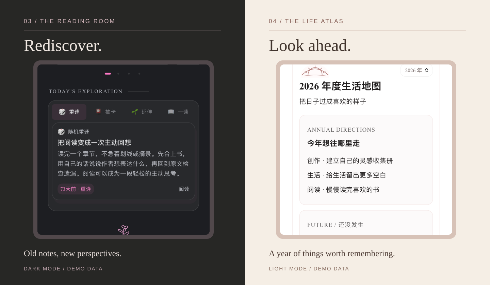
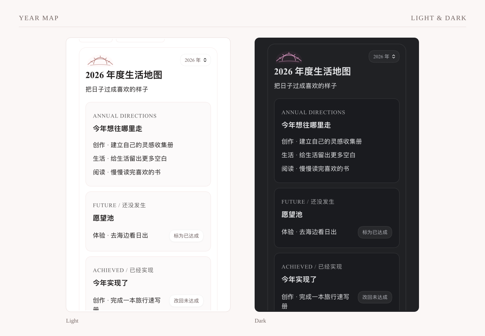

PERSONAL MAGAZINE · OBSIDIAN HOME

<h1 align="center">把每天的生活，过成一份自己的杂志。</h1>

生活、艺术与知识探索，在同一个阅读空间里。

<a href="assets/README.md">实机图册</a> · <a href="docs/design-notes.md">设计笔记</a> · <a href="#关注上架">关注上架</a>

实机界面 · 演示数据 · 桌面与手机 · 完整模板筹备中

---

## 不是另一个待办清单。

打开 Obsidian，可以不只是为了查找笔记或完成任务。也可以安排今天，欣赏一幅画，读一点世界的消息，再遇见一篇快忘了的旧笔记。

Personal Magazine 将生活、审美与知识放在同一个阅读空间里。像翻阅杂志一样，从自己的今天出发，看看外面的世界，再回到自己的内心与知识。

| **EVERYDAY** | **DAILY ART & NEWS** | **EXPLORATION** |
| :--- | :--- | :--- |
| 今天有方向，也有余白。 | 每天为好奇心留一点时间。 | 让收藏的知识重新流动。 |
| 今日计划 · 周重点 · 月方向 · 日记 | 画作展签 · 沉浸赏画 · 新闻剪报 | 随机重逢 · 抽卡 · 延伸 · 一读 |

## 01 / 日常的仪式感

**在一天开始的时候，知道自己想怎么过。**

把今日待办、每周重点、本月方向与日记放在一处。持续事项按天记录进展，一次性事项可以标记完成；今日战果可以撤销。训练建议和餐食灵感减少一些日常选择的摩擦。

在日常之外，给自己留一段艺术时间：完整画作、作品展签、沉浸式放大与背景阅读。新闻剪报则提供少量了解外部世界的线索，而不是无限滚动的信息流。

<a href="assets/desktop/everyday-overview.png">查看电脑实机首页</a> &nbsp; · &nbsp; <a href="assets/desktop/daily-art-and-news.png">查看每日艺术与新闻</a> &nbsp; · &nbsp; <a href="assets/display/mobile/everyday-overview.svg">查看手机首页</a>

## 02 / 让你的知识库重新成为一个有趣的地方

| 阅读方式 | 你可以做什么 |
| :--- | :--- |
| 随机重逢 | 偶遇一篇曾经喜欢的笔记，再读一遍。 |
| 今日抽卡 | 先回忆，再翻看参考答案。 |
| 今日延伸 | 顺着已有兴趣发现一个新的问题。 |
| 今日一读 | 通过串联、复核或新的视角重读已有知识。 |

刊头的笔记、概念和双链统计也是知识入口；标题搜索、分类、最近浏览和今日编辑放在轻量书签中。知识不只被存起来，也有机会重新出现在生活里。

[探索区实机图册 →](assets/README.md#04--今日探索)

## 03 / 不只记录今天，也看见一年

月度生活看板让本月方向、每周安排、日记和回望彼此连通。年度生活地图则把年度方向、愿望池、已实现的愿望、书影音、生活足迹与回望放在一起。

计划和真实发生的事分开记录。生活不只有完成率，也有那些原本没有列进清单、却值得留下来的瞬间。

[月度生活看板](assets/desktop/month-dashboard.png) · [年度生活地图](assets/desktop/year-map.png)

## 04 / 为不同的阅读情境设计

桌面宽屏以分栏、目录和图文并置组织信息；手机用自然的纵向阅读、横滑和按需展开承载同样的内容。深色主题保留相同的视觉层级和功能。

<a href="assets/README.md"><strong>浏览完整实机图册 →</strong></a>

> 展示采用真实界面截图、等比裁切和重新排版，不重绘 UI。手机展示图裁去可见系统状态栏。画作局部来自早期实机预览，新闻为演示专题。原图保留在仓库。

## 关注上架

**Personal Magazine 完整模板 · 筹备中**

当前公开仓库是产品预览，不是可安装的完整模板。现有个人版本基于 Obsidian、Markdown、CSS snippets 与 DataviewJS，计划将其整理为独立、可安装的付费模板。

| 你可能想知道 | 目前的情况 |
| :--- | :--- |
| 什么时候能买？ | 尚未上架；购买入口、价格和交付范围将在正式发布时公布。 |
| 如何安装？ | 计划提供独立模板、演示数据与安装指南；兼容性和插件要求仍需验证。 |
| 每日内容会自动更新吗？ | 现有个人版本通过独立 AI 工作流辅助更新；这并非 Obsidian 原生能力，需要额外配置与运行成本。正式版支持范围待公布。 |
| GitHub 发行版是付费下载吗？ | 不是。这里的 Releases 用于版本公告及可能的免费体验文件；正式付费文件将通过独立购买渠道交付。 |

想收到发布消息，可在仓库顶部选择 **Watch → Custom → Releases**。

<a href="https://github.com/jadecoltrane/Obsidian-Home/releases"><strong>查看发行公告 →</strong></a> &nbsp; · &nbsp; <a href="docs/design-notes.md">了解设计背后的思考</a>

