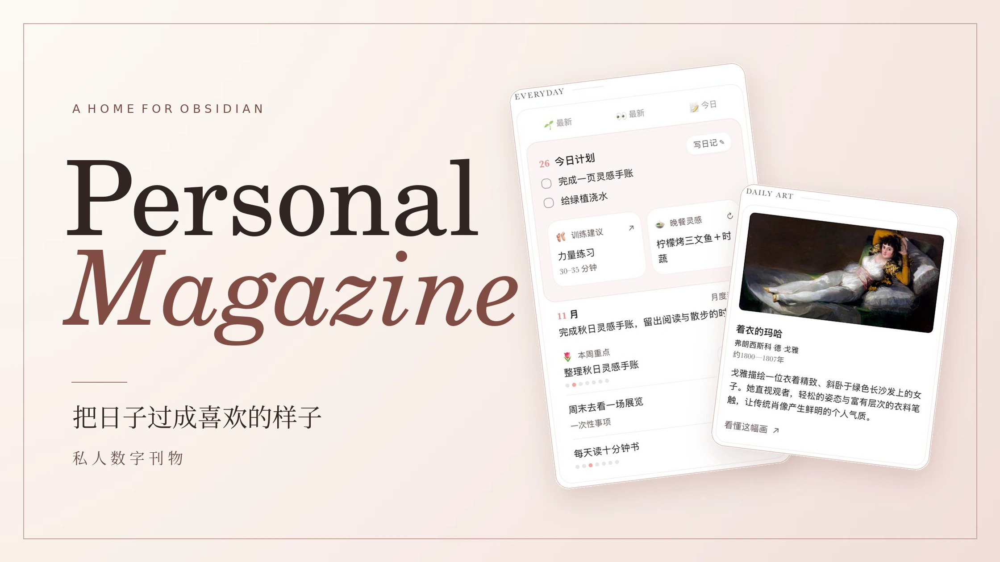
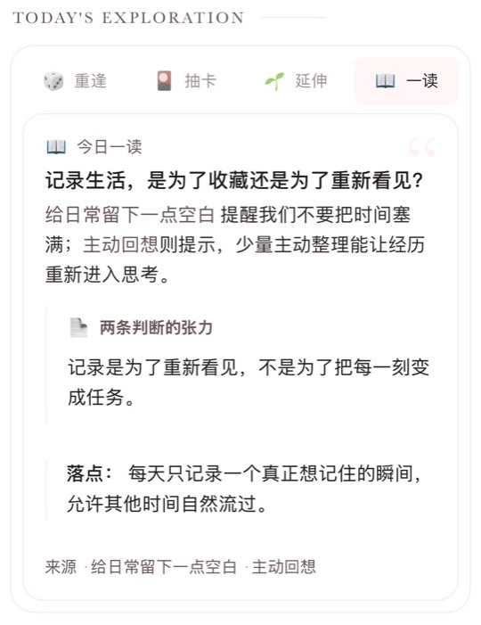

  

  一个为自己做的 Obsidian 首页。 
  打开它，看看今天想做什么。也可以看一幅画，或和过去写下的一句话重逢。

  <a href="assets/README.md"><strong>翻看手机实机图册&nbsp; ↗</strong></a> &nbsp;·&nbsp;
  <a href="docs/design-notes.md">设计笔记</a>

### 给今天留一点空间

打开首页就能写日记，把想做的事一件件勾掉。本周想慢慢推进的事，也有地方记下今天走了哪一步。旁边还留了两个小位置，给今天的训练和一顿想吃的晚饭。

### 每天看一幅画，重读一篇笔记

赏画从一张完整的画开始。想看清布料的纹理，就放大一点。想知道画里的人是谁，就拉开底部的作品故事。

随手翻翻简讯，或在「今日探索」里抽一道问题、重遇一篇旧笔记。也可以沿着一条感兴趣的线索读下去，看看两篇旧笔记放在一起会想到什么。

  
  &nbsp;
  

### 到年底，再回头看看

月度看板收拢本月的安排和实际做过的事。到了年末，可以翻回那些读过的书、看过的展、想实现的愿望，还有一些没排进计划、却值得记住的小事。

---

Personal Magazine 是一个正在日常使用的独立设计项目，目前开放设计展示。个人版本用 Markdown、CSS snippets 和 DataviewJS 搭建，部分日更内容由独立的 AI 工作流更新。可安装模板尚未发布。

喜欢这个首页，可以点个 **Star** 留着慢慢看，也欢迎在 [Issues](https://github.com/jadecoltrane/Obsidian-Home/issues) 告诉我，你最想把哪个角落搬进自己的 Obsidian。
