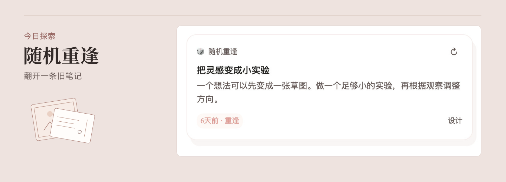
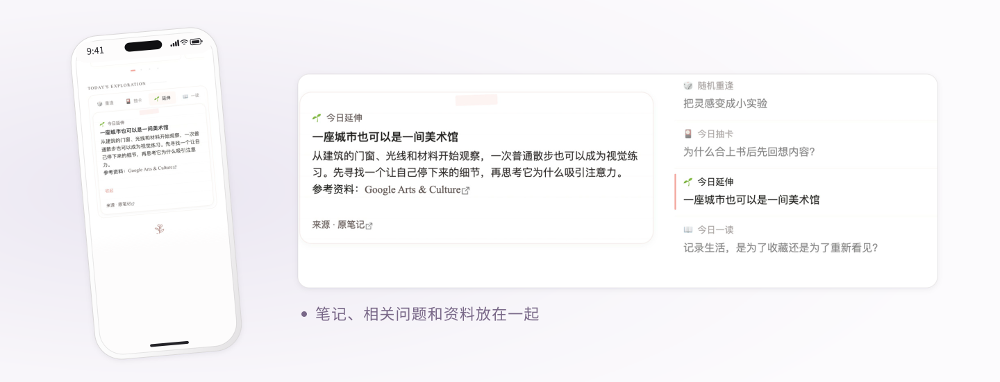
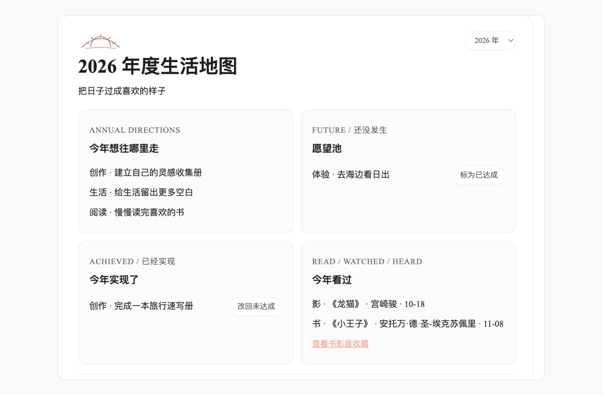

# AI 日常看板与阅读系统

## 这个 Home 是做什么的

这是一个基于 Obsidian 的个人首页，把生活记录、每日阅读和知识探索放在一起。你可以每周写一段话，说说下周想做什么。AI 会帮你整理成日常看板，再把平时留下的记录汇成月度和年度回看。打开首页，可以记一笔今天的生活，也可以坐下来读点东西。

## 日常生活

今日安排、本周重点和本月方向都在首页。持续进行的事和一次性的安排各有位置。想记下今天发生了什么，可以直接在首页展开日记，顺手看看运动和餐食灵感。

## 每日艺术与新闻

每天认识一幅画。电脑上可以把画幅和展签放在一起看，手机上可以打开沉浸式赏画，再接着读作品的背景和故事。看完画，也可以翻几条精选新闻，顺着来源继续阅读。

## 今日探索

四个入口把读过、写过的内容重新带到眼前，也留出一点空间给新的问题。

### 随机重逢

随机翻出一条旧笔记。卡片保留创建时间，可以顺着链接回到原文，看看当时在想什么。

### 今日抽卡

从一个小问题开始，先试着回想，再点开参考答案。读过的知识也能拿来给自己出一道题。

### 今日延伸

从已有笔记里的一个话题出发，看看它能引出什么新问题。卡片会附上相关资料，有兴趣就接着往下读。

### 今日一读

换个角度读自己的笔记。可以从一个反例、一处联系或一个新问题读进去，也可以随时打开原文。

## 月看板 / 年看板

### 月看板

按月翻看读过的内容、记下的事和这一阵子的探索。每周的安排和实际经历也能放在一起回顾。

### 年看板

把一年里重要的主题、经历和兴趣串起来。读过的书、看过的展、实现的愿望和留下的生活记录，都可以在这里重读。

## 主题跟随 Obsidian 变化

切换 Obsidian 的深浅主题或强调色，首页的背景、卡片和控件会一起变化。

当前为演示版。展示图取自真实界面，手机状态栏为模拟展示。AI 整理与内容更新由独立工作流负责。
