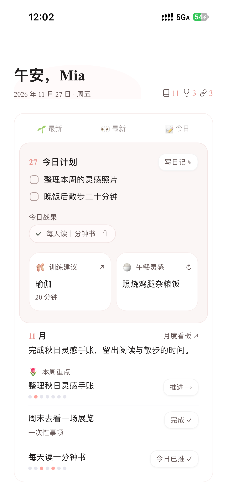
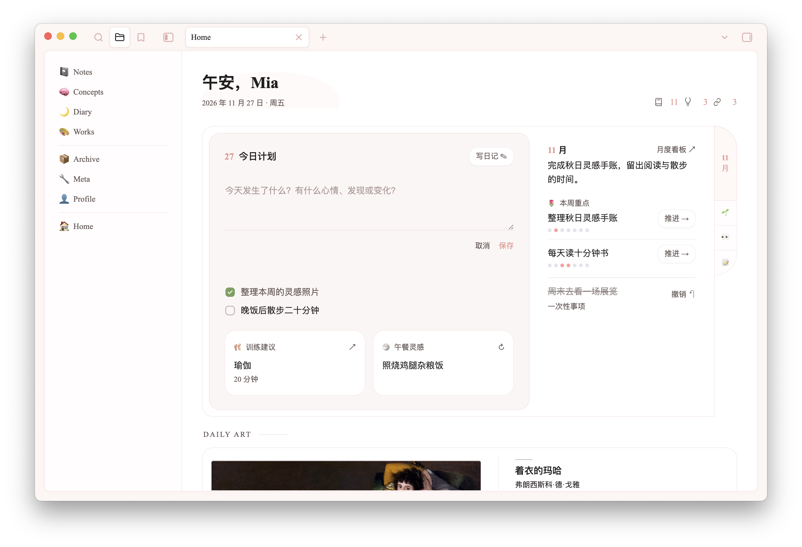
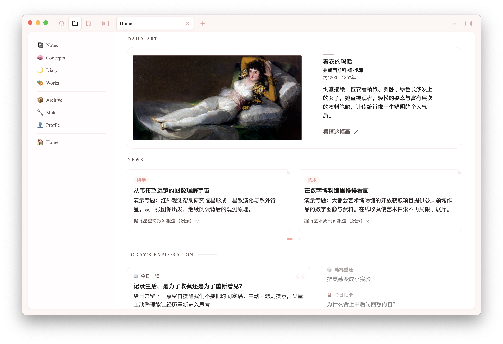
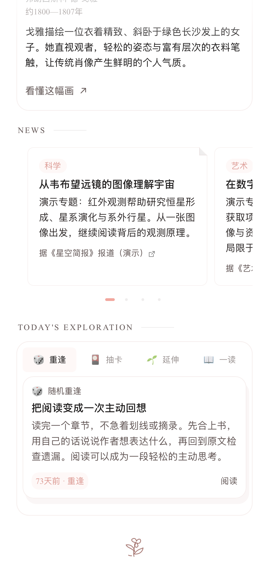
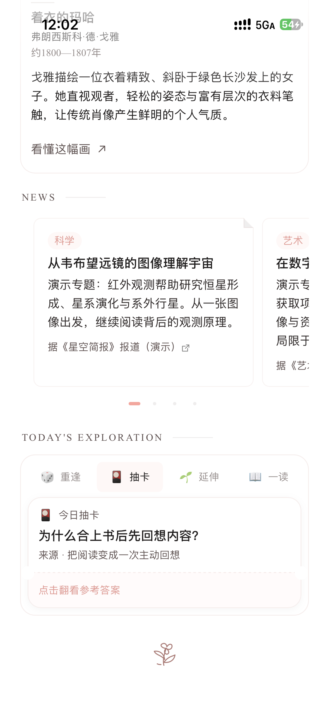
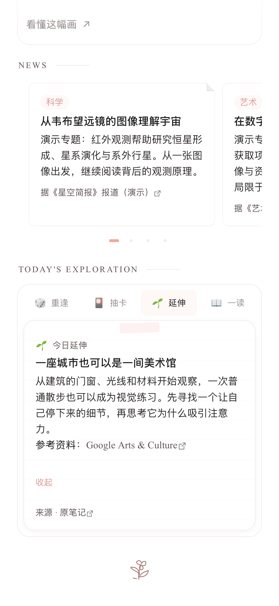
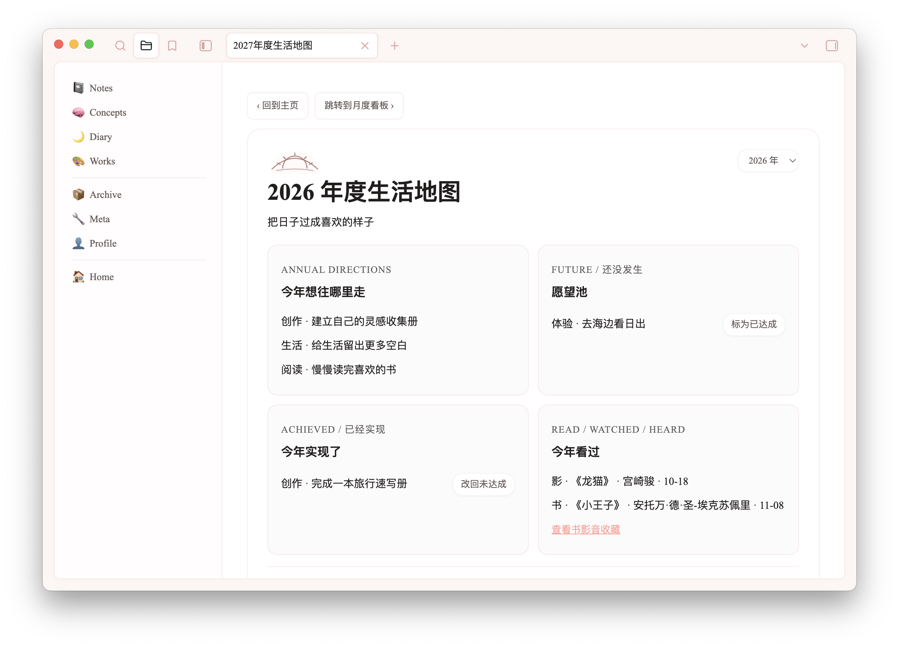
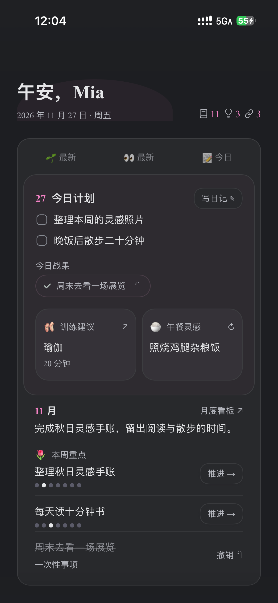
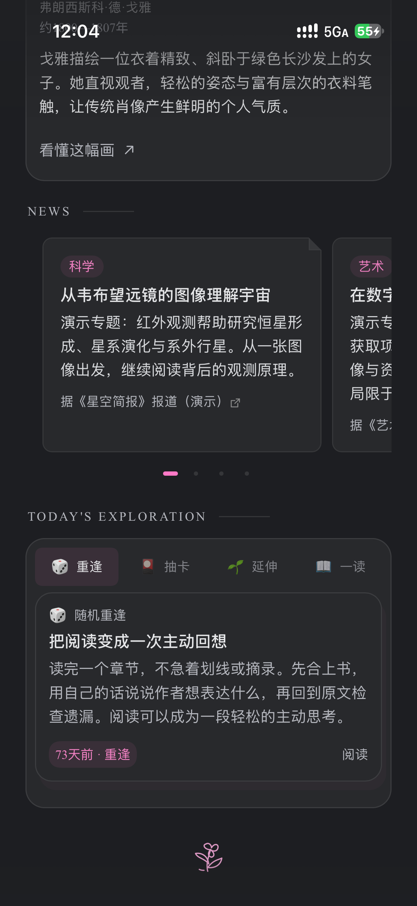

<strong>PERSONAL MAGAZINE</strong> · Obsidian 个人杂志

<h1 align="center">一个每天都想打开的 Obsidian 首页</h1>

安排今天，看一幅画，读一点世界的消息，再遇见一篇快忘了的旧笔记。

  <a href="assets/README.md">手机与电脑实机图册</a> ·
  <a href="docs/design-notes.md">设计笔记</a> ·
  <a href="#关注上架">关注上架</a>

  

## 设计思路｜把知识库变成一份个人杂志

一个知识库可以存下很多东西，但收藏本身不意味着我们还会回去阅读。一个计划系统可以列出很多任务，但生活也不只由待办组成。

Personal Magazine 想把 Obsidian 的首页做成一个有日常生活、审美体验和知识探索的个人空间。打开它不一定要搜索、写作或完成任务，也可以只是看一幅画，读一段文字，或看看最近自己在关心什么。

页面采用杂志式的阅读顺序：**从自己的今天出发，看看外面的世界，再回到自己的知识。** 月度与年度看板把这些日常片段放回更长的时间尺度。

视觉上借鉴纸本杂志、手账与美术馆展签：衬线字、轻薄边框、留白、低饱和主题色，以及新闻剪报、拍立得、票根、和纸信笺等细节。不同形式服务于不同阅读方式，而不是用装饰堆满页面。

## 01 · 刊头与知识库入口

问候、日期、笔记数、概念数和双链数构成杂志的刊头。统计也是入口：按标题搜索、按分类浏览，或查看概念与知识之间的联系。最新笔记、最近浏览和今日编辑则放在轻量书签中，按需打开。

设计重点是让已有知识容易找到，又不让管理工具占据整个首页。

  
  
  

## 02 · EVERYDAY｜今天怎么过

首页的生活区把三个时间层次放在一起：本月方向、每周重点、今日计划。它们分别回答想往哪里走、这一周推进什么、今天具体做什么。

持续事项可以按天记录推进，一次性事项可以标记完成；今日待办可勾选，已经记录的进展可以撤销。日记直接在首页展开书写。训练建议与餐食灵感放在同一个区域，帮助减少日常选择的摩擦。

这里不追求每天把清单全部打勾。比完成率更重要的是看见自己真实做过的事。

  
  

## 03 · DAILY ART｜每天看一幅画

首页像一面小小的展墙：完整画作、作品名称、画家、年代和简短展签。想继续看时，可以打开沉浸式赏画，缩放笔触与细节，阅读作品的背景、故事、观看线索及画派，并沿资料入口进一步了解。

不是把艺术作为背景装饰，而是为每天留出一点独立的审美时间。即使没有艺术史基础，也可以从观察一幅画开始。

  

## 04 · NEWS｜和外面的世界保持联系

新闻以短篇剪报呈现，保留分类、标题、摘要和来源入口。桌面并排阅读，手机横向滑动，长内容按需展开。

设计目标不是复刻一个无限滚动的信息流，而是在自己的日常之外提供少量阅读线索。截图中的新闻是明确标注的演示专题，并非实际新闻报道。

## 05 · TODAY'S EXPLORATION｜让知识重新流动

收藏的知识如果只有搜索入口，就需要我们主动想起它。探索区提供四种不同的阅读方式，每次选择一个即可，不必把它们变成新的每日任务。

| 模块 | 设计目的 |
| --- | --- |
| 随机重逢 · 拍立得 | 随机遇见一篇旧笔记，看到它是什么时候写下的，重新建立联系。 |
| 今日抽卡 · 票根 | 从笔记中提出问题，先回想，再翻看参考答案，练习主动回忆。 |
| 今日延伸 · 信笺 | 从已有知识走向相邻领域，提供新的探索方向和参考资料。 |
| 今日一读 · 引文卡 | 将已有内容串联、复核或放进新的问题里，形成一段可独立阅读的文字。 |

  

  
  
  
  

## 06 · 月度生活看板与年度生活地图

首页之外，还有两个可以来回跳转的时间尺度。

**月度生活看板**汇总当月方向与每周安排，也保留月度回望与日记入口。计划与实际经历分开呈现，不把还没做的事情算作已经发生。

**年度生活地图**把年度方向、愿望池、已经实现的愿望、看过的书影音、生活足迹与年度回望放在一起。除了目标完成情况，也关心那些没有预先写进计划、却值得留下来的经历。

  
  

## 07 · 桌面、手机与深浅主题

宽屏利用横向空间，生活区分栏、赏画图文并置，探索区使用目录与阅读卡。手机则沿着一条自然的纵向阅读流，借助页签、横滑与按需展开完成相同的任务。

深色主题沿用相同的信息层级与视觉语义，以炭灰纸面和主题强调色适应不同阅读环境。统一的是设计语言和功能，而不是强行复制同一套布局。

  
  
  

[查看全部实机截图与交互状态 →](assets/README.md)

## AI 作为杂志的编辑，而不是首页的主角

现有个人版本基于 Obsidian、Markdown、CSS snippets 与 DataviewJS。日更画作、简讯和部分知识探索由独立 AI 工作流辅助筛选与整理，内容更新与页面样式、原始笔记分离。

AI 工作流需要另行配置及运行，并不是 Obsidian 自带的每日更新能力。正式模板的具体功能范围、自动化配置及兼容性要求将在发布时说明。

## 关注上架

当前仓库公开的是个人版本的设计与演示数据预览，**不是可安装的完整模板**。正式模板计划付费发布，价格、上架时间和安装要求以发布公告为准。

想收到上架消息，可以在仓库顶部选择 **Watch → Custom → Releases**。

[查看发布页 →](https://github.com/jadecoltrane/Obsidian-Home/releases) · [进一步阅读设计取舍 →](docs/design-notes.md)
