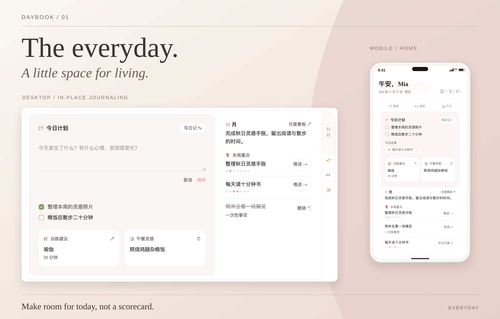
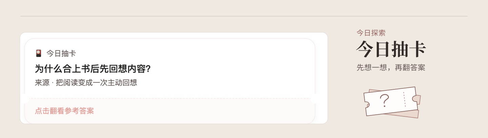
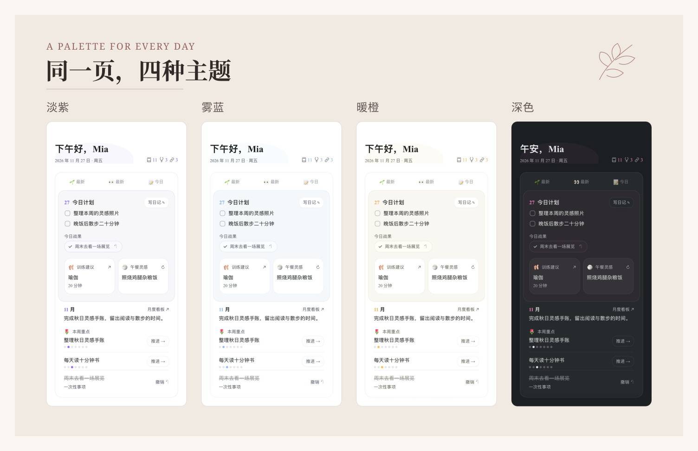

# AI 日常看板与阅读系统

Obsidian Home 把计划、日记和阅读放进同一个 Obsidian 首页。每周写几句想做的事，AI 会帮你整理成每日安排。平时打开首页，可以记日记、看一幅画，或重新读到一条旧笔记。

## 从一句话开始

> 下周想每天读十分钟，周末去看一场展，再找时间整理灵感照片。

AI 把这段话整理成一周重点和每日安排。做了什么、遇到什么，可以随手记下来。到了月底或年底，这些记录会出现在相应的回看里。

## 日常生活

打开首页，先看今天有什么安排。一天过完，可以在同一页展开日记，写下想记住的事。桌面端并排显示今日安排和本周重点，手机上可以一路往下读。

## 每日艺术与新闻

每天看一幅画。电脑上把画幅和作品展签并排放，手机上可以打开沉浸式赏画，继续读作品背景。旁边还有几条精选新闻，感兴趣就顺着来源往下读。

## 今日探索

已经收进 Obsidian 的内容，还可以再读一次。打开首页，从四个入口里挑一个。

### 随机重逢

翻到一条旧笔记，也看看它是什么时候写下的。想知道当时在想什么，可以打开原文。

### 今日抽卡

把读过的内容变成一道小问题。先想想自己会怎么答，再点开参考答案。

### 今日延伸

顺着旧笔记里的一个问题，找到值得接着读的材料。

### 今日一读

从一个新问题、反例或联系出发，换个角度读回熟悉的内容。原笔记也随时可以打开。

## 月看板 / 年看板

### 月看板

按月份翻看当时的安排、真实经历和月度回顾，想知道某件事是什么时候发生的，也可以顺着记录找回去。

### 年看板

一年里读过的书、实现的心愿、留下的记录，慢慢连成一张自己的生活地图。

## 主题跟随 Obsidian 变化

浅色、深色和强调色都跟随 Obsidian 的设置。下面展示同一个首页的三种浅色强调色和深色主题。

当前为演示版。AI 整理与内容更新由独立工作流负责。展示使用真实界面截图，封面保留原图里的状态栏。
