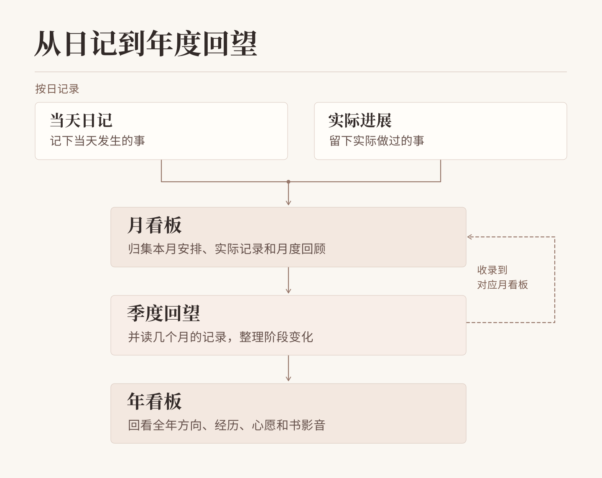

# 一页日常

这是我给 Obsidian 做的自定义 Home 页。我用 **Dataview 插件**读取和展示笔记里的内容，页面样式用的是**自己写的 CSS**。

打开首页，可以看今天有什么安排、写几句日记、欣赏一幅画，或翻到一条旧笔记。每周写下想做的事，独立的 AI 工作流会帮我整理成本周重点和每日安排。时间久了，还可以从月看板和年看板回看留下的记录。

## 从一句话开始

> 下周想每天读十分钟，周末去看一场展，再找时间整理灵感照片。

**每周写一次。** AI 会从这段话里分出持续事项和一次性安排。「每天读十分钟」可以持续记录进展，「周末去看展」是做完就能划掉的一件事。整理后的内容放进本周重点，和每天打开首页时看到的安排相连。

**平时记录发生了什么。** 照片整理到一半，或临时换了一个展，都可以在日记或进展里留一笔。月底回看时，当初想做什么和后来做了什么都找得到。艺术、新闻和知识探索由另一条工作流更新，想阅读的时候，打开首页就有一个起点。

## 从日记到年度回望

日记和实际进展是回顾的起点。当月的计划与发生过的事分别保留，月看板把它们放在一起看。到了季度，可以并读几个月的记录，回顾会放进相应的月看板。年看板再用一年的尺度回看曾经在意的事、实现的心愿和留下的记录。

**回顾怎么生成**　AI 根据对应时间范围内已有的记录提炼内容。月回顾看具体安排和经历，季度回望看几个月之间的变化，年度回顾把全年值得留下的主题和经历串起来。月底想起某个细节，还能从看板回到当月日记。

## 日常生活

早上可以先扫一眼「今日计划」，再看「本周重点」里有哪些事情还在推进。持续做的事可以更新进展，一次性的安排可以在完成后标记。想临时改计划，也可以直接编辑「本周重点」，增删事项、调整类型，或为某一项补上备注。训练建议和午餐灵感放在旁边，想活动一下或还没想好吃什么时，可以随手看看。

点「写日记」就能在首页展开编辑区，记一件事、几句感受，或者今天想留下来的细节。电脑上可以并排读计划和周重点，手机上顺着同一页往下翻。

**日常怎么生成**　工作流从每周写下的自然语言里拆出持续事项和一次性安排，整理本周重点，并结合已有记录形成每日安排。实际完成的事、临时变化和日记，仍由我在首页更新。

## 每日艺术与新闻

### 每日一画

电脑上把画幅和展签并排放，可以边看构图和细节，边读作者、年代和作品简介。手机上点开「看懂这幅画」，可以用更大的画面赏画，再往下读创作背景和作品故事。

**选画思路**　挑适合展示完整画幅、也有作者、年代和背景资料可读的作品。有了作品资料，AI 把基本信息和一小段赏析整理成首页的展签，把背景和故事留给点开后的阅读页。

### 新闻剪报

在手机上左右滑动看下一张剪报。卡片下方的**四个圆点**显示翻到哪里，高亮的是当前页。先读标题和短摘要，感兴趣再点开卡片里的来源。电脑上可以同时看见两张卡片。

**新闻怎么生成**　以原报道为材料，把一条内容压缩成标题和简短摘要，再保留出处作为继续阅读的入口。卡片上的分类帮助扫读。

## 今日探索

存进 Obsidian 的笔记，也可以换个方式再读一次。想随手翻翻，可以选随机重逢。想检验自己到底记得多少，可以抽一道题。想多读一点，还有顺着一个问题往外找资料，以及把旧笔记从头读一遍的入口。手机上通过页签切换，电脑上可以同时看到当前卡片和其他入口。

**四张卡怎么生成**　它们都从已有笔记出发，保留回到来源的入口。

| 入口 | 从笔记生成什么 |
| --- | --- |
| 随机重逢 | 翻出一条旧笔记，保留原题和记录时间，给一小段预览。 |
| 今日抽卡 | 从笔记提取一个适合回想的问题，参考答案单独放在展开区。 |
| 今日延伸 | 把笔记里的想法延伸成一个新问题，再附上可继续查阅的资料。 |
| 今日一读 | 选一个新视角、反例或联系，整理成可先读摘录、也可展开的篇章。 |

### 随机重逢

随机翻出一条旧笔记，看看它是什么时候写下的。比如再次遇见「把灵感变成小实验」，先读卡片上的一小段，也可以点回原笔记，找回当时是怎么想到这个点子的。

### 今日抽卡

从读过的内容里抽一道问题，例如「为什么合上书后先回想内容？」题面先留给你一点思考时间，想好了再打开参考答案。卡片也保留笔记来源，想弄清某个观点的来龙去脉，可以读回原文。

### 今日延伸

从原笔记里的一个想法多走一步。例如「一座城市也可以是一间美术馆」这张卡，从一次普通散步出发，把门窗、光线和材料变成可以留心观察的东西。卡片一并留下参考资料和原笔记，读完可以继续追下去。

### 今日一读

从一个问题、反例或新联系出发，重新读熟悉的笔记。「记录生活，是为了收藏还是为了重新看见？」就从一条关于给日常留白的笔记里展开。首页先给一段摘录，有兴趣可以展开全文，再回到那条引出问题的原笔记。

## 月看板 / 年看板

### 月看板

按月份切换，先看到当时的生活方向，再看从每周汇入的安排和已经记下的实际经历。比如一个月里几次提到想看展，可以在月看板里对照计划和记下的出行日期。月度回顾保留了「打开当月日记」的入口，想起一个细节时可以回到当时的记录。

### 年看板

把一年拉到同一张生活地图上。想去的地方和想尝试的事可以先放进愿望池，实现后移到「今年实现了」。读过的书、看过的电影和听过的音乐也有位置。年末回头看，可以从这些具体的小事里找出这一年反复关心的主题，以及那些后来变得重要的兴趣。

## 主题跟随 Obsidian 变化

首页用清浅的纸面和细分隔线组织内容。日记有地方写，艺术区像翻到一张展签，新闻像随手翻几则剪报。手机端和电脑端都随 Obsidian 主题变化。切换浅色、深色或强调色时，背景、卡片和操作提示会一起变化。下面用手机首页的完整应用区域对照淡紫、雾蓝、暖橙和深色。从顶部问候到本周重点，可以看到配色对整页的影响。

AI 整理及内容更新由独立工作流负责。封面和章节中的产品界面均取自实机截图。
