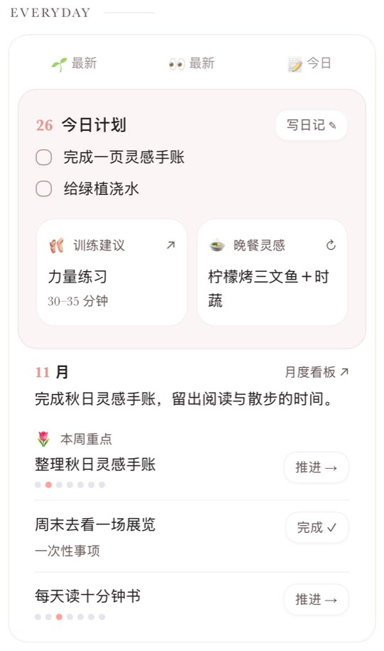
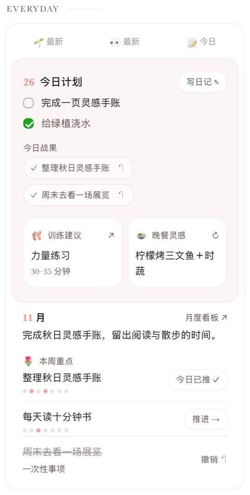
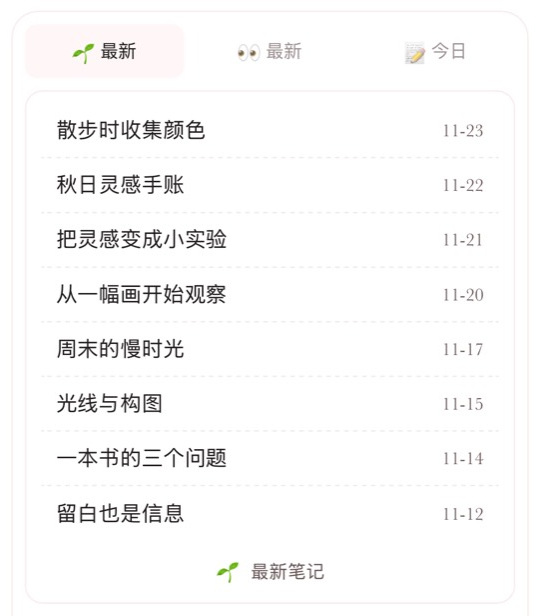
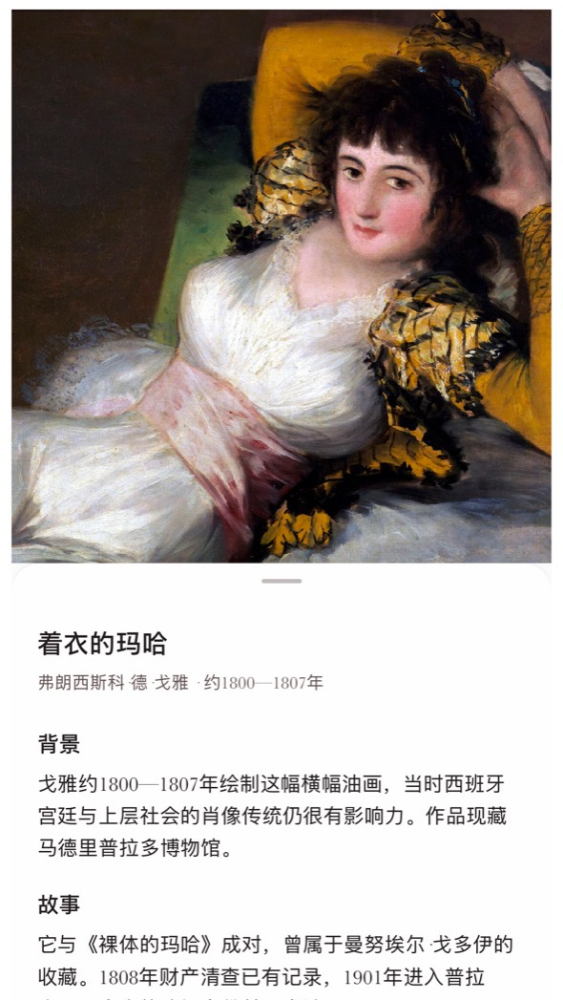
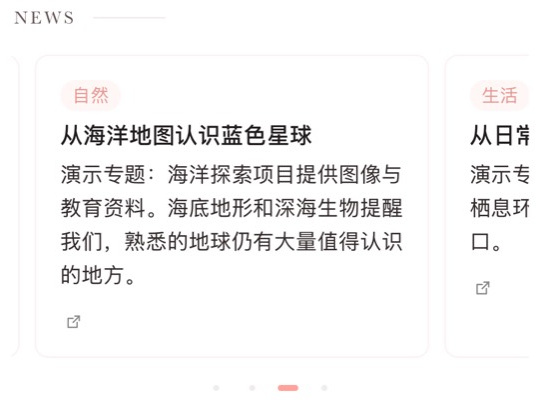
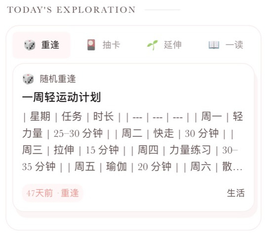
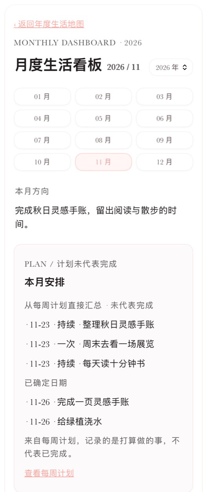
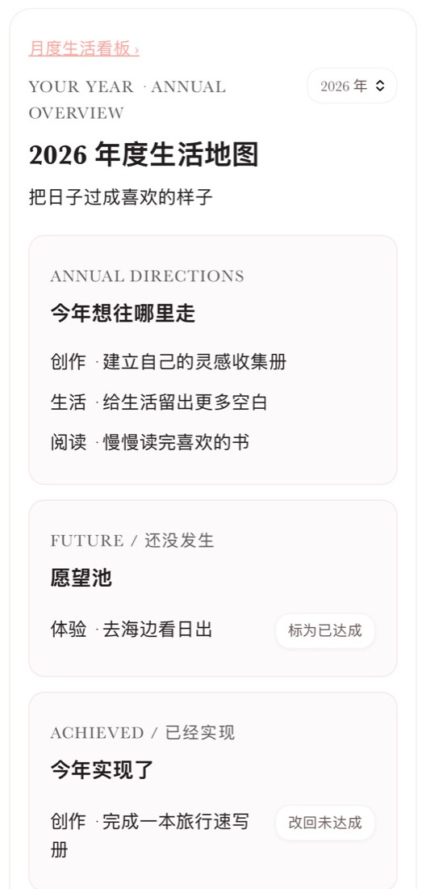

# Personal Magazine · 私人数字刊物

**An Obsidian home that feels like a magazine, not a dashboard.**

把 Obsidian 打造成一本每天都想打开的私人杂志：安排今天的生活，重逢过去的思考，欣赏艺术，发现新的知识。

> 正在日常使用和迭代的工作台设计项目。目前为设计展示阶段，尚未发布可安装的通用模板。

## EVERYDAY · 让生活有方向，而不只是待办

今天具体做什么、本周想推进什么、本月想往哪里走，在同一张生活卡片里各有自己的位置。

- **今日计划**：原地编辑、勾选完成；随手写下日记，无需在多个页面之间寻找入口。
- **本周重点**：持续事项记录每天的推进，一次性事项可以完成；进展支持撤销。
- **生活灵感**：训练建议、餐食灵感与近期笔记入口，让首页也照顾日常生活。

| 勾选与推进前 | 勾选与推进后 |
| :---: | :---: |
|  |  |

## YOUR LIBRARY · 让收藏的笔记重新可见

从首页打开笔记分类、搜索标题、查看概念和近期更新的内容，随时回到原笔记。工具入口按需展开，不占用常态阅读空间。

| 标题搜索与分类 | 近期笔记列表 |
| :---: | :---: |
|  |  |

## DAILY ART · 每天给自己一间小小的美术馆

每天遇见一幅画。先在首页欣赏完整作品和简短介绍，再进入沉浸式赏画界面，放大细节、拖动画面，按需展开作品的背景与故事。手机端的讲解采用可调节的底部卡片，画面与阅读共享空间。

| 首页作品卡 | 展开背景与讲解 |
| :---: | :---: |
|  |  |

截图中的画作为弗朗西斯科·德·戈雅的《着衣的玛哈》，现藏于普拉多博物馆。

## NEWS · 让外部世界进入日常

用横滑简讯卡片浏览经过筛选的内容，保留分类、摘要和原文入口。不是追求无限信息流，而是让有限的阅读更有方向。

| 横滑浏览简讯 |
| :---: |
|  |

## TODAY'S EXPLORATION · 让知识主动回来找你

收藏不等于掌握。四种探索方式，让过去的笔记与新的知识重新进入生活：

| 方式 | 体验 |
| --- | --- |
| 🎲 随机重逢 | 随机遇见一篇旧笔记，换一篇或打开原文。 |
| 🎴 今日抽卡 | 先主动回想一个问题，再翻看参考答案。 |
| 🌱 今日延伸 | 从已有兴趣出发，探索尚未接触的知识。 |
| 📖 今日一读 | 串联、比较已有观点，形成新的理解与行动落点。 |

| 随机重逢 | 今日抽卡 |
| :---: | :---: |
|  |  |

| 今日延伸 | 今日一读 |
| :---: | :---: |
|  |  |

## YOUR YEAR · 从今天到一整年的生活地图

生活不是一张需要填满的进度表。月度看板汇总已经安排的事情，并与实际完成区分；年度地图收拢方向、愿望、书影音和真正发生的生活足迹。

| 月度安排 | 年度方向与愿望 | 年度足迹与回望 |
| :---: | :---: | :---: |
|  |  |  |

## Design philosophy · 设计理念

**私人杂志 × 生活手账 × 原生 App 交互。**

- 用编辑式排版、统一字族、留白和真实内容建立秩序，而不是堆叠装饰。
- 让重要的内容容易发现，让下一步行动容易完成，也允许只是看看、读读。
- AI 在幕后承担内容筛选和策划，用户在前台获得安静、可追溯的阅读体验。
- 桌面与手机共享视觉语言，按照各自的屏幕与阅读习惯组织内容。

更多设计取舍见 [设计笔记](docs/design-notes.md)。

## How it's built · 实现方式

现有个人版本基于 Obsidian、Markdown、CSS snippets 与 DataviewJS，部分每日内容由独立的 AI 工作流更新。视觉、数据和内容更新尽量分离。

本页介绍真实运行的个人工作台，不代表未来模板已经完成兼容性测试；AI 日更也需要独立配置，并非仅安装 Obsidian 即可实现。

## Interested? · 想要这样的工作台？

如果你也希望每天打开的是一个既能安排生活、又能阅读与探索的空间，欢迎 **Star** 收藏这个项目，或在 [Issues](https://github.com/jadecoltrane/Obsidian-Home/issues) 分享你最想使用的功能。

上文手机端截图使用演示数据，点击可查看大图。独立可安装模板、售价与发布时间尚未确定。

---

Personal Magazine is an independent design project built on Obsidian.
