# Personal Magazine · 实机图册

[← 返回产品首页](../README.md) · [设计笔记](../docs/design-notes.md)

本页按使用情境展示手机及电脑界面。已核对的界面采用演示数据；新闻为演示专题。点击图片查看原图。未裁切、转码或压缩新上传的原始文件。

## 01 · 刊头与生活区

| 手机首页 | 较早的首页状态 | 深色首页 |
| :---: | :---: | :---: |
|  | <a href="mobile/everyday-overview-earlier.png">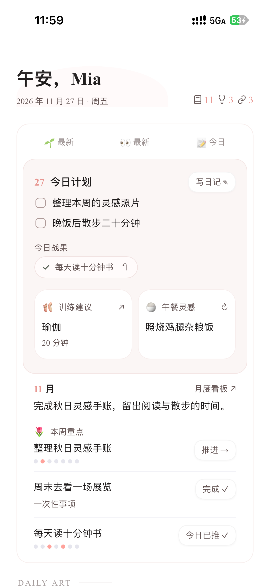</a> |  |

| 电脑首页 | 首页展开日记 |
| :---: | :---: |
| <a href="desktop/everyday-overview.png">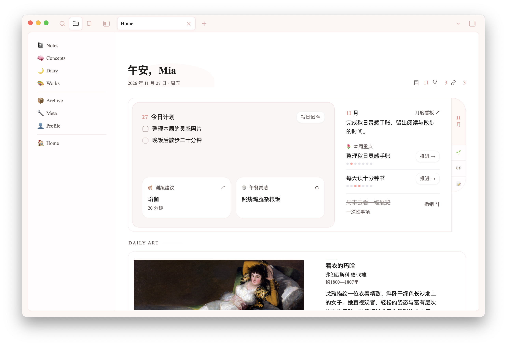</a> |  |

## 02 · 知识库入口

| 标题搜索与分类 | 概念入口 | 最新笔记 |
| :---: | :---: | :---: |
| <a href="mobile/library-search.png">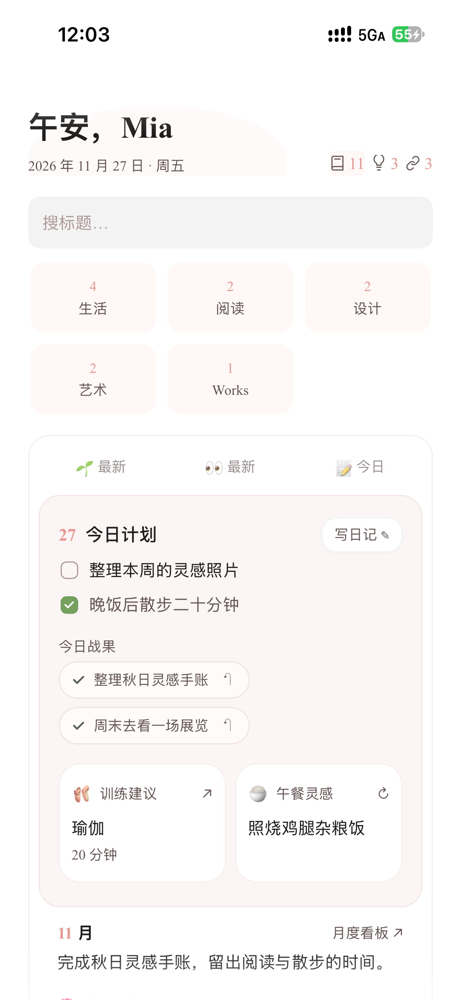</a> | <a href="mobile/library-concepts.png">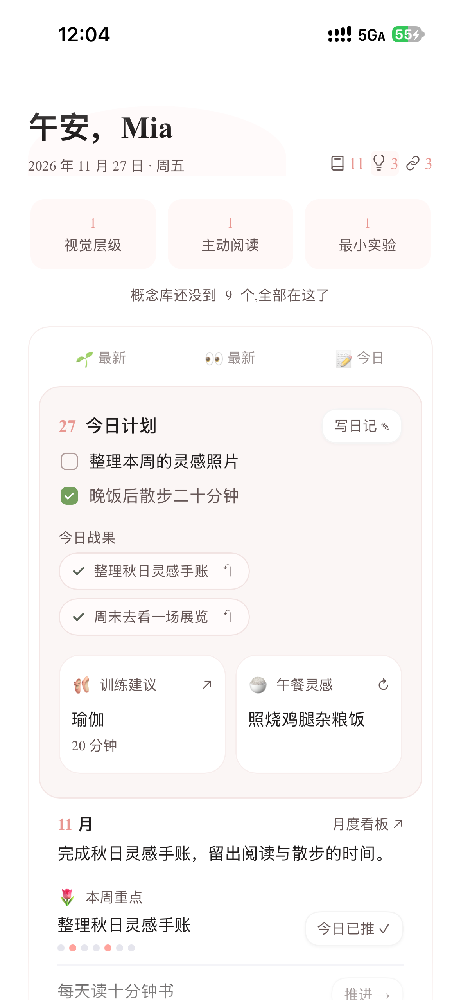</a> | <a href="mobile/library-recent.png">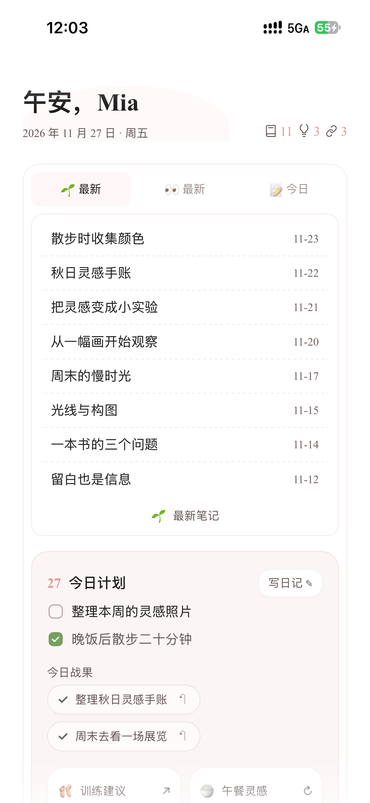</a> |

| 电脑搜索分类 | 电脑最新笔记 | 电脑最近浏览 |
| :---: | :---: | :---: |
| <a href="desktop/library-search.png">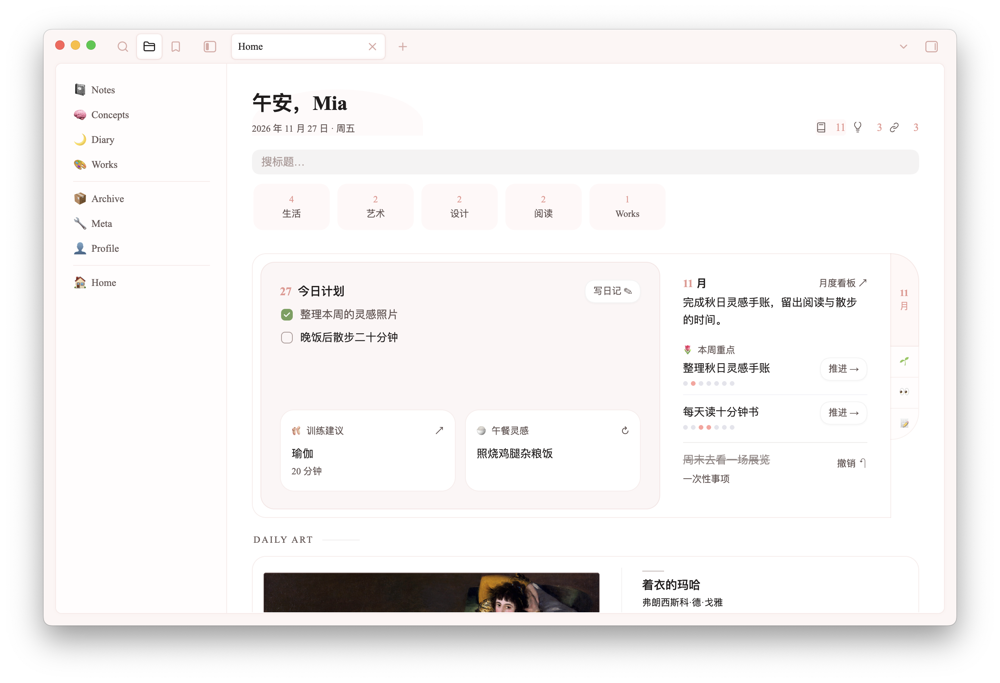</a> | <a href="desktop/library-recent.png">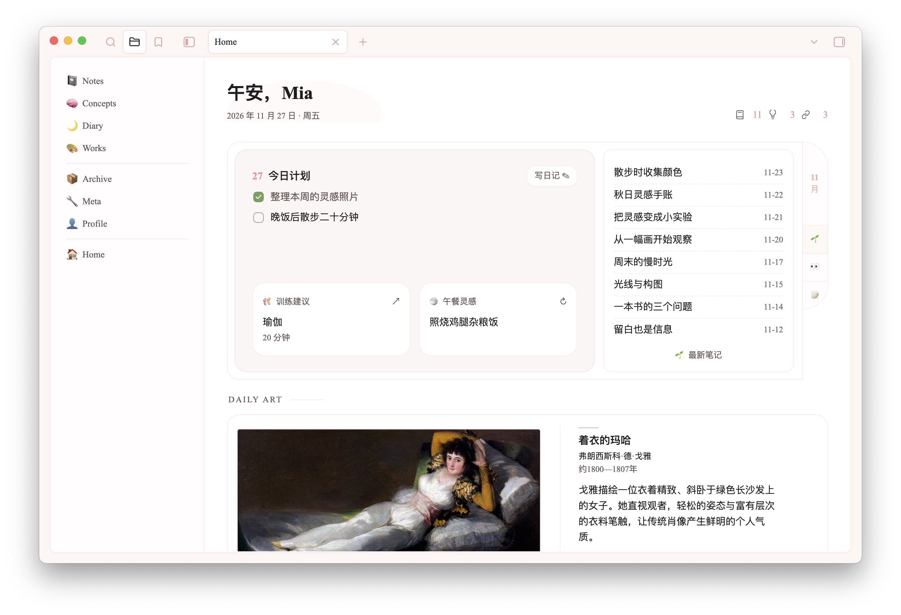</a> |  |

## 03 · 每日画作与新闻

手机的新闻横滑状态可在下方探索图册中看到。

## 04 · 今日探索

| 随机重逢 | 今日抽卡 | 今日延伸 | 今日一读 |
| :---: | :---: | :---: | :---: |
|  |  |  | <a href="mobile/exploration-daily-read.png">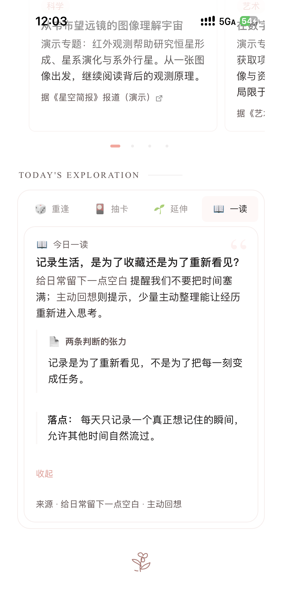</a> |

| 电脑随机重逢 | 电脑今日抽卡 |
| :---: | :---: |
| <a href="desktop/exploration-rediscover.png">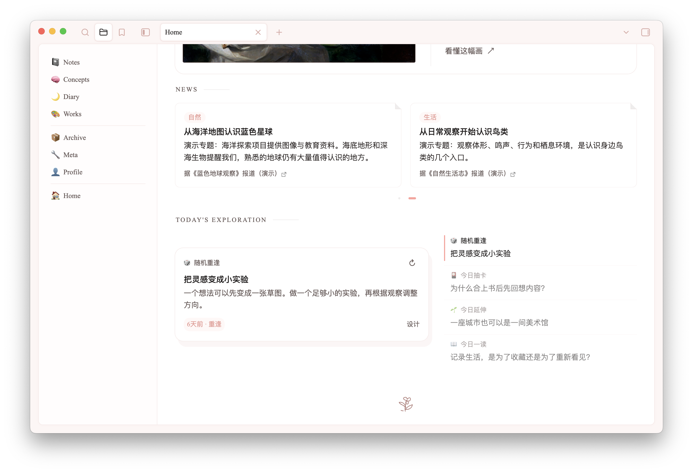</a> | <a href="desktop/exploration-flashcard.png">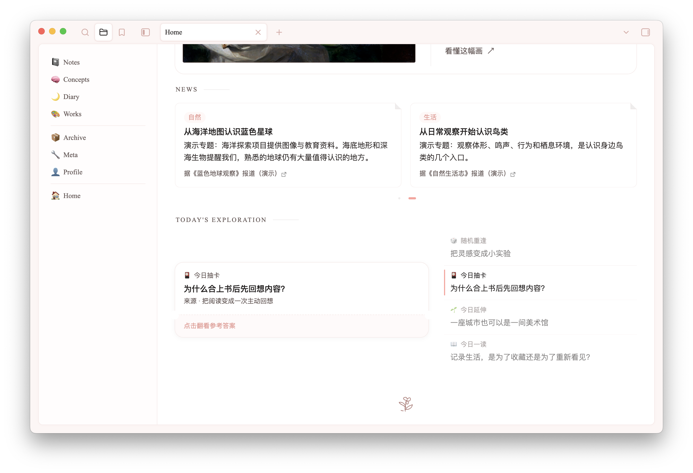</a> |

| 电脑今日延伸 | 电脑今日一读 |
| :---: | :---: |
| <a href="desktop/exploration-discover.png">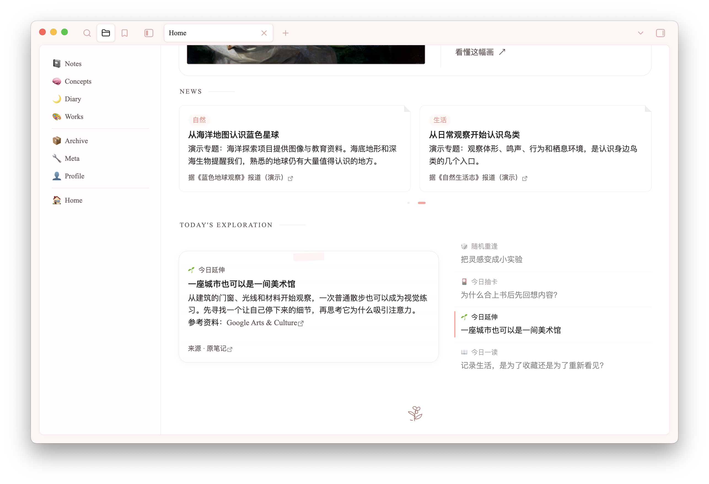</a> | <a href="desktop/exploration-daily-read.png">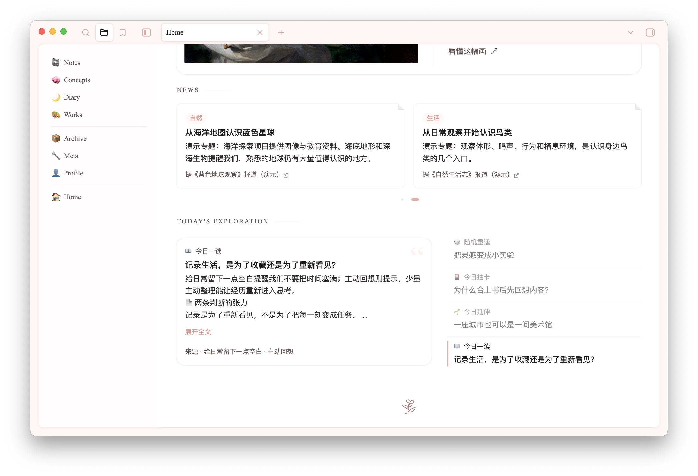</a> |

## 05 · 月度与年度

| 手机月度看板 | 手机年度地图 | 深色月度看板 | 深色年度地图 |
| :---: | :---: | :---: | :---: |
| <a href="mobile/month-dashboard.png">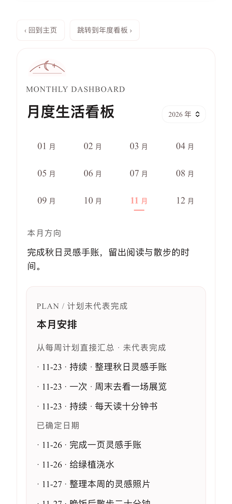</a> | <a href="mobile/year-map.png">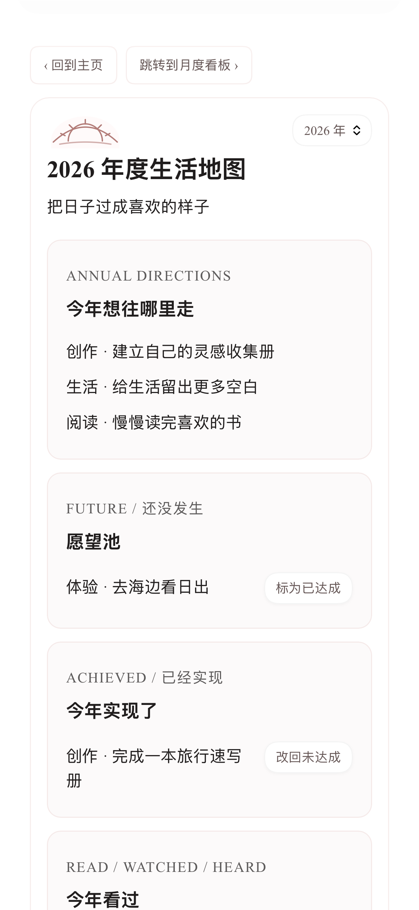</a> | <a href="mobile/dark-month-dashboard.png">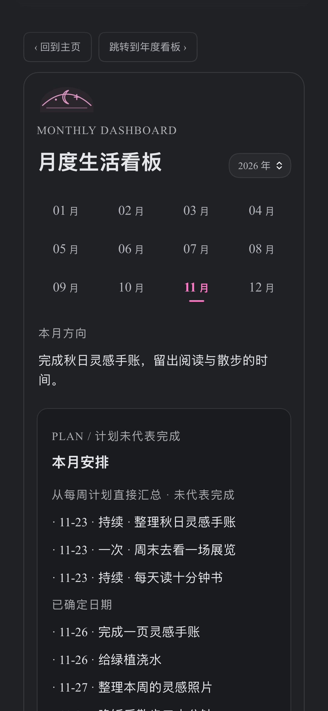</a> | <a href="mobile/dark-year-map.png">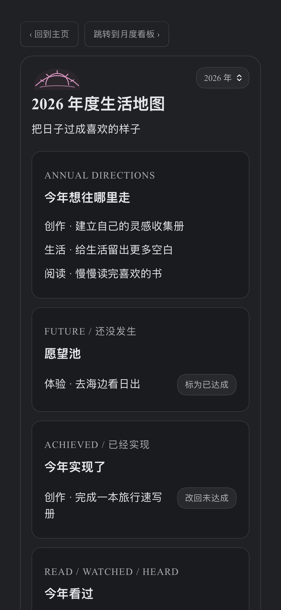</a> |

| 电脑月度看板 | 电脑年度地图 |
| :---: | :---: |
| <a href="desktop/month-dashboard.png">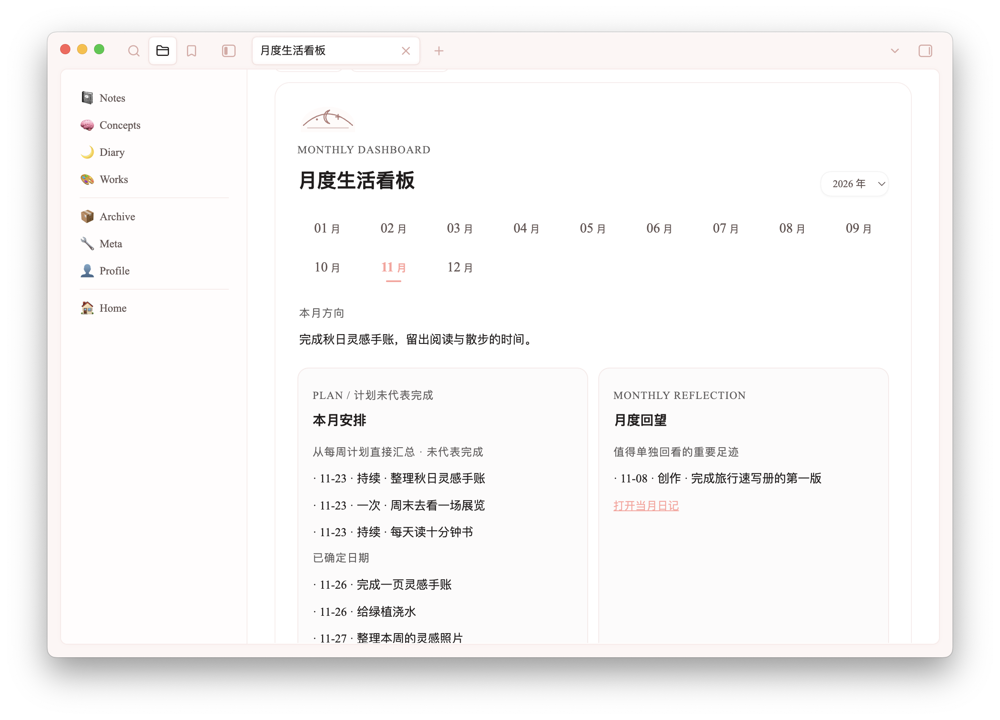</a> |  |

## 补充原图

[手机补充截图](mobile/additional/) · [电脑补充截图](desktop/additional/) · [早期预览拼图](product-preview.webp)

补充原图保留原始文件名，暂未加入模块图文展示。
