# 手机实机图册

[← 返回 Personal Magazine](../README.md)

截图使用演示数据。点击任意图片可查看大图。

## 今天与这一周

把勾选与推进前后的状态放在一起。持续事项记录每天的进度，一次性事项可以完成，也能撤销。

| 勾选与推进前 | 勾选与推进后 |
| :---: | :---: |
| <a href="mobile/everyday-plan.jpg">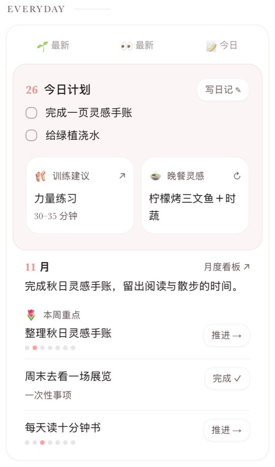</a> | <a href="mobile/everyday-progress.jpg">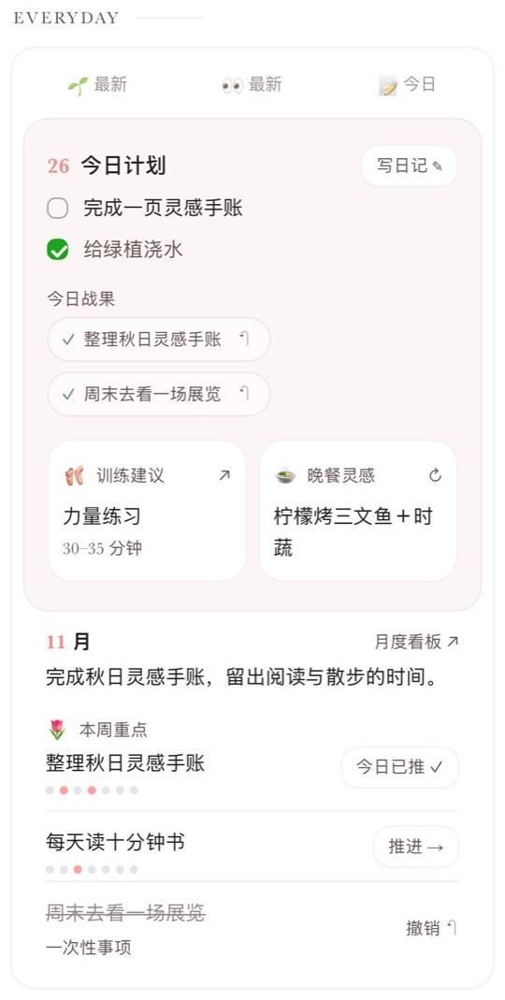</a> |

## 随手翻笔记

从首页按标题搜索、查看分类或翻看最近更新的笔记。

| 标题搜索与分类 | 近期笔记列表 |
| :---: | :---: |
| <a href="mobile/library-search.jpg">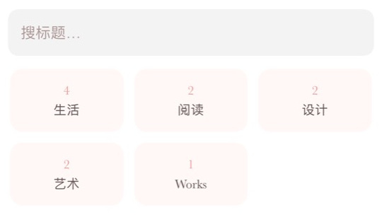</a> | <a href="mobile/library-recent.jpg">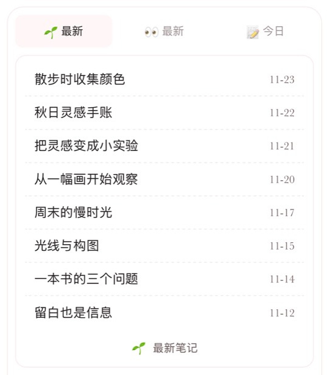</a> |

## 每日赏画

点进作品后可以放大细节、拖动画面，或展开作品背景与故事。画作为戈雅的《着衣的玛哈》，现藏于普拉多博物馆。

| 首页作品卡 | 展开背景与讲解 |
| :---: | :---: |
| <a href="mobile/daily-art-home.jpg">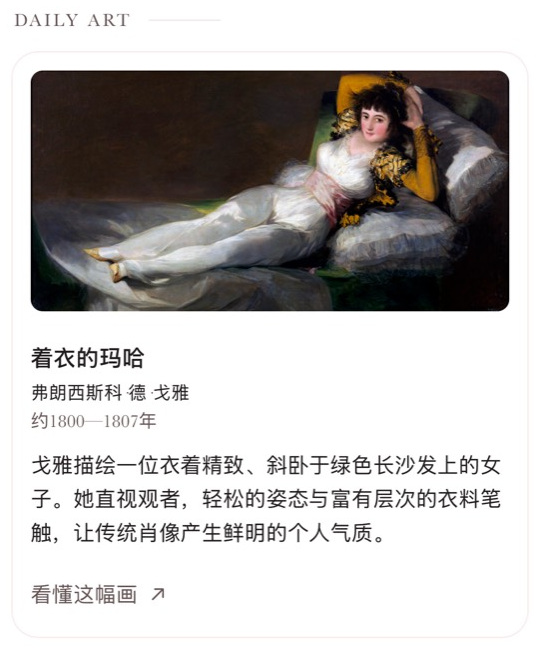</a> | <a href="mobile/daily-art-details.jpg">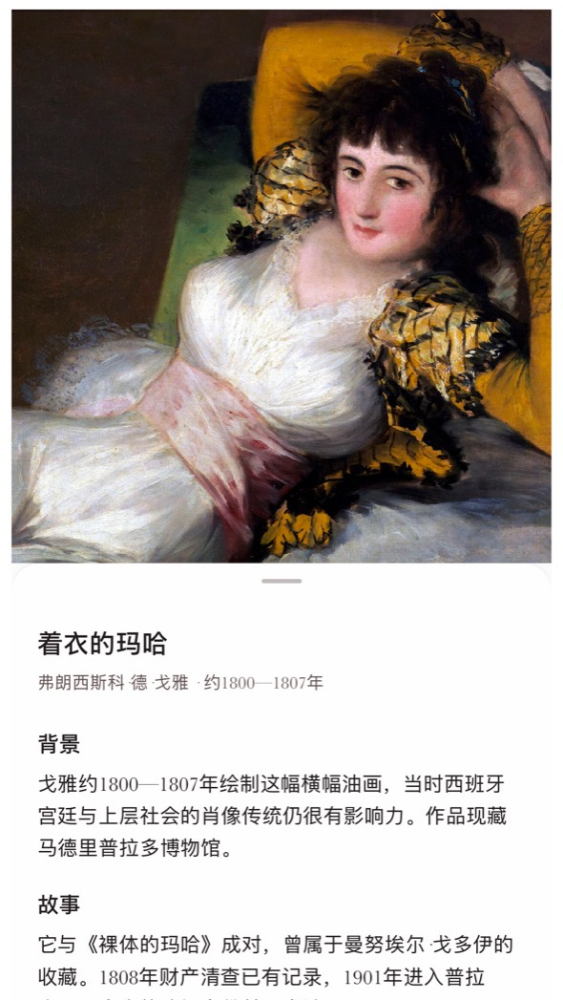</a> |

## 横滑简讯

每张卡片保留分类、摘要与原文入口。

| 横滑浏览简讯 |
| :---: |
| <a href="mobile/news-carousel.jpg">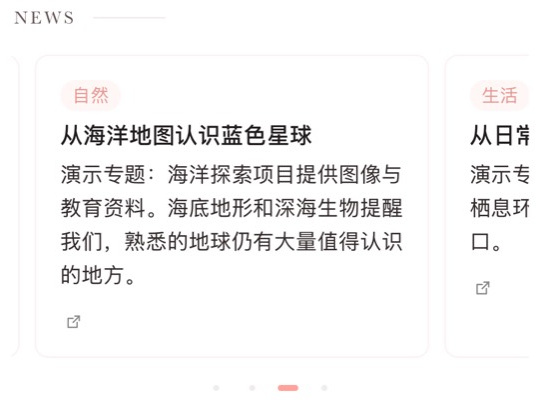</a> |

## 今日探索

四种打开旧笔记和发现新知识的方式，每天可以换一种。

| 随机重逢 | 今日抽卡 |
| :---: | :---: |
| <a href="mobile/exploration-rediscover.jpg">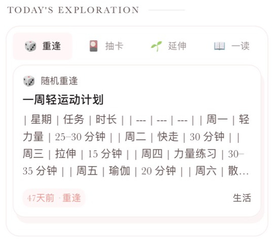</a> | <a href="mobile/exploration-flashcard.jpg">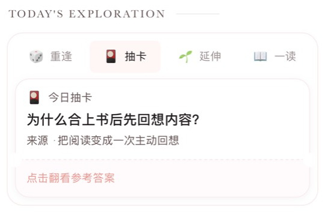</a> |

| 今日延伸 | 今日一读 |
| :---: | :---: |
| <a href="mobile/exploration-discover.jpg">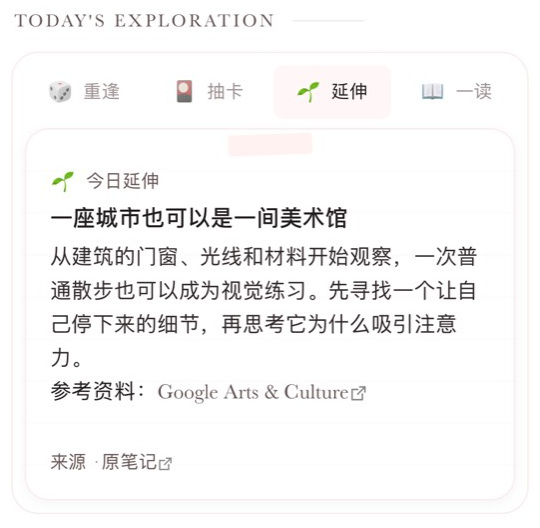</a> | <a href="mobile/exploration-daily-read.jpg">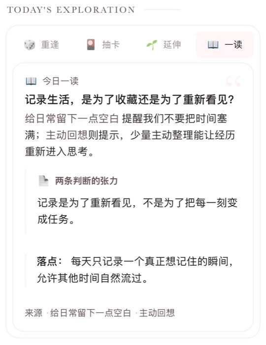</a> |

## 月度与年度

从本月安排一路翻到年度方向、愿望、书影音和真正发生的生活足迹。

| 月度安排 | 年度方向与愿望 | 年度足迹与回望 |
| :---: | :---: | :---: |
| <a href="mobile/month-dashboard.jpg">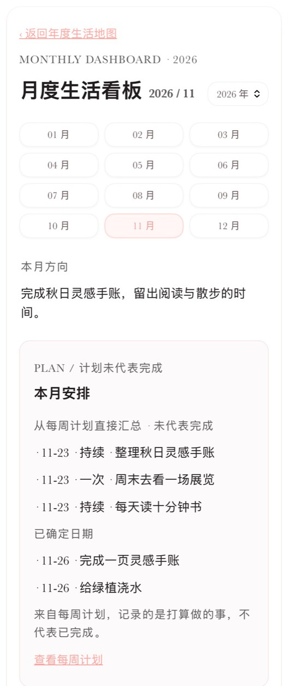</a> | <a href="mobile/year-overview.jpg">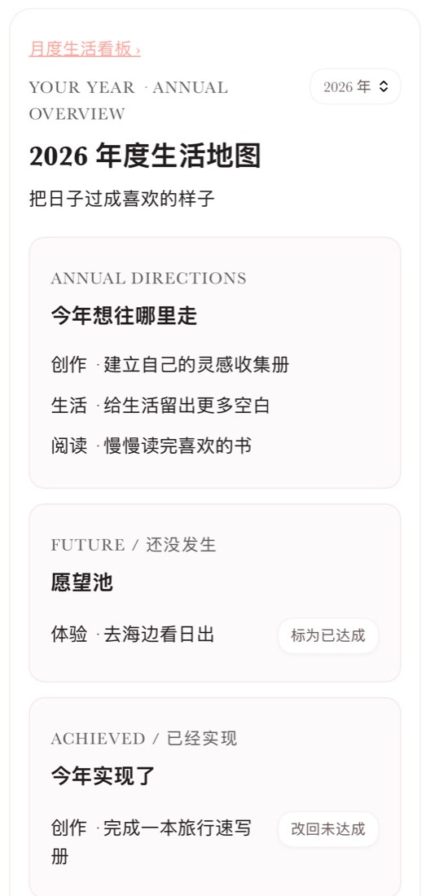</a> | <a href="mobile/year-review.jpg">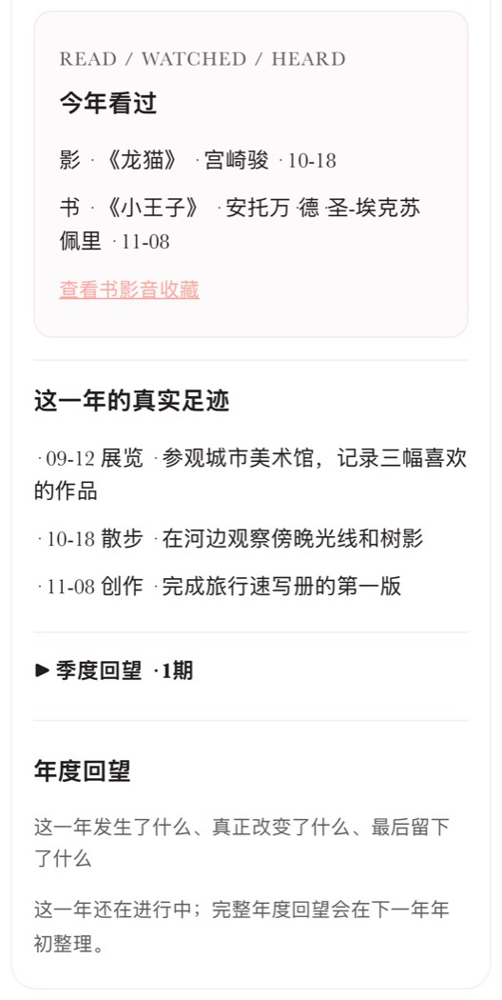</a> |
